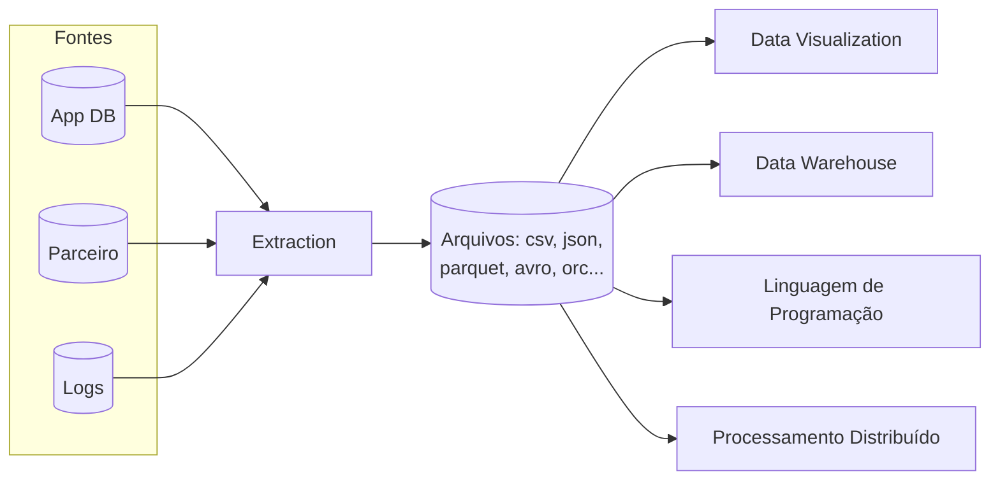
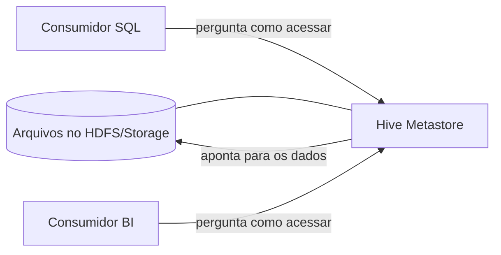

# Aula 1 — Catálogo de Dados

Do Hive Metastore ao AWS Glue Data Catalog

<!--
Aula 1 da GDBD. Origem: slides 1-60 do deck Google Slides.
Narrativa: estudo de caso -> open source -> trazendo para AWS -> serviço
gerenciado -> prós/contras -> prática. Ver .kiro/steering/didatica.md.

PONTUALIDADE: esta é a aula 1. Avise a turma que as aulas começam no horário,
com tolerância máxima de 10 minutos. A partir da aula 2, os primeiros 30 min
são para dúvidas e para terminar atividades.
-->

---

## Apresentações

Antes de começar, uma rodada rápida:

- Qual o seu nome?
- De onde você é?
- Com o que você trabalha hoje?
- Qual seu objetivo nesta disciplina?
- Conta uma curiosidade!

---
layout: center
---

## Introdução ao curso

---

## Objetivos do curso

- Introdução aos serviços de Big Data da AWS
- Deep dive em cluster Hadoop na AWS (**EMR**)
- Data Lake na AWS
- Laboratórios práticos

---

## Trabalho final: Data Lake do meu clube

Vale **100% da nota**. **Individual ou em grupo de até 3**, você escolhe.

- Cada grupo recebe **um clube** da Premier League (pela matrícula).
- Monta **Raw → Clean → Curated** na **sua conta AWS** e responde 8 perguntas com Athena.
- Prova com **bytes lidos** por que Parquet + partição reduzem custo.
- Prazo: **15 dias corridos após a última aula**. Custo: de centavos a ~US$ 1.
- Os **labs não valem nota**, mas cada um é uma peça do trabalho.

Enunciado: [`avaliacao/trabalho.md`](https://github.com/obernardocosta/big-data/blob/main/disciplinas/gdbd/avaliacao/trabalho.md) · resumo no [último slide do deck](https://obernardocosta.github.io/big-data/gdbd/trabalho-final)

<!--
Apresente o trabalho já na Aula 1, em 3 minutos, para a turma ler o enunciado
cedo e conectar cada lab ao trabalho. Deixe claro: a nota é 100% o trabalho
(presença e participação não entram na conta; aprovação com nota >= 6,0). Reforce: individual OU grupo, e que cada
um roda na PRÓPRIA conta AWS. Avise que contas novas podem ter o Glue
bloqueado e que CTAS no Athena é uma rota aceita.
-->

---

## O que você vai levar da Aula 1

Ao final de hoje, você será capaz de:

- Explicar **por que** análises precisam de um **catálogo**, não de arquivos soltos.
- Relacionar **Hive Metastore → AWS Glue Data Catalog** (open source → gerenciado).
- Criar uma **tabela catalogada** à mão e ver **schema evolution** (Lab 01).
- Automatizar a catalogação com o **Glue Crawler** (Lab 02).

---

## Roteiro de hoje (terça · 18h30–22h · ~3h30)

| Tempo | Bloco |
|---|---|
| 0:00–0:15 | Abertura, combinados e **pontualidade** |
| 0:15–0:45 | Estudo de caso: o problema de "arquivos soltos" |
| 0:45–1:15 | Catálogo de dados; Hive Metastore → Glue Data Catalog |
| 1:15–1:35 | O serviço gerenciado: integrações e preço |
| 1:35–1:50 | **Intervalo** |
| 1:50–2:20 | **Lab 01** — tabela catalogada (5 min de demo + 15 de prática) |
| 2:20–2:35 | "Catalogar à mão não escala" → Crawler |
| 2:35–3:15 | **Lab 02** — Glue Crawler (5 min de demo + 30 de prática) |
| 3:15–3:30 | Fechamento + o que vem na Aula 2 |

> **Gestão de tempo (aula cheia, 3h30 com 2 labs):** a **introdução do curso**
> (objetivos, avaliação, referências) é rápida — não gaste mais de 15 min nela.
> Se o tempo apertar, o **schema evolution** do Lab 01 (passo 5) e a 2ª rodada do
> Lab 02 viram **demonstração**; o essencial é cada aluno ter **uma tabela
> catalogada** (manual e via Crawler). Esta é a aula mais densa do curso.

<!-- Esta é a 1ª aula: avise que começa 18h30 em ponto (tolerância 10 min). -->

---

## Avaliação

- **100% da nota é o trabalho final** (Data Lake do meu clube).
- Individual ou em grupo de até 3, na sua conta AWS. Aprovação com nota **≥ 6,0**.
- Presença e participação **não entram no cálculo**, e não há quiz.
- Os labs não valem nota, mas são o treino do trabalho.

Critérios: [`avaliacao/README.md`](https://github.com/obernardocosta/big-data/blob/main/disciplinas/gdbd/avaliacao/README.md)

<!--
A avaliação é 100% o trabalho final, corrigido em parte por script e em parte
por rubrica (repositório privado). Não há quiz nesta edição. Reforce: os labs
não valem nota, mas quem os faz com atenção chega ao trabalho com o caminho andado.
-->

---

## Referências

- Big Data Analytics Options on AWS
- Data Engineering with AWS
- Designing Data-Intensive Applications
- Learn Amazon SageMaker
- Storage Best Practices for Data and Analytics Applications
- Data Analytics Lens (AWS Well-Architected)
- AWS Certified Data Analytics Study Guide
- Spark: The Definitive Guide

---
layout: section
---

# Módulo 1

Introdução aos serviços de Big Data na AWS

---

## Estudo de caso

Trabalhamos em um produto **Cloud Native**. Com o tempo, o produto precisa
iniciar suas iniciativas de dados para:

- Apoiar a decisão baseada em dados
- Analisar desempenho comercial
- Analisar o mercado
- Integrar com produtos parceiros

Existem diversas fontes possíveis, com:

- Tamanhos diferentes
- Formatos diferentes
- Schemas de dados diferentes

---
layout: center
---

## O problema central

### Como analisar dados de fontes heterogêneas de forma escalável?

---

## Arquitetura inicial

A extração envia os arquivos **no formato que cada fonte disponibiliza**, e os
consumidores os utilizam de formas diferentes.

---

## Perguntas que essa abordagem levanta

- Como fica o **esquema de dados** nessa abordagem?
- Como controlar as **versões** do esquema?
- É possível garantir que **todos** os sistemas consigam ler **todos** os arquivos?
  - xml, json, xls, csv, parquet, avro, orc, etc.
- O que fazer quando os schemas **mudarem**?
- Como **juntar** dados assim?
- É possível saber **quais dados** o projeto já tem?

<!--
Deixe a turma tentar responder antes de avançar. Essas perguntas motivam o
conceito de catálogo de dados no próximo slide.
-->

---
layout: center
---

## A resposta: Catálogo de Dados

Um catálogo provê **Virtualization**, **Discoverability**,
**Schema Evolution** e **Performance**.

---

## O que um Catálogo de Dados provê

- **Virtualization** — análises em SQL querem **tabelas**, não arquivos. O
  catálogo mantém uma visão estável de tabelas, mesmo que os componentes de
  análise mudem.
- **Discoverability** — ajuda a descobrir quais conjuntos de dados existem;
  guarda metadados como dono e frequência de atualização.
- **Schema Evolution** — registra o esquema dos arquivos ao longo do tempo,
  permitindo ler cada arquivo no esquema correto e monitorar mudanças.
- **Performance** — mapeia os arquivos de cada tabela em **partições**, evitando
  trazer para a memória arquivos desnecessários à consulta.

---

## Catálogo de Dados no mundo open source

**Hive Metastore**

- Fundado em 2010
- Componentes:
  - **Query Engine** — executa o SQL
  - **Metastore** — o catálogo, sobre o HDFS

---

## Atualização da arquitetura com o Metastore

Os consumidores **perguntam ao Hive Metastore** como acessar os dados, em vez de
conhecer os arquivos diretamente.

---
layout: section
---

# Trazendo para o mundo Open Source

Prós e contras

---

## Open Source — Prós

- Apoio da comunidade
- Liberdade de implementação (sem **vendor lock-in**)
- Liberdade de customização
- Dezenas de ferramentas disponíveis

---

## Open Source — Contras

- Dificuldade de implementação
- Dificuldade de suporte
- Monitoramento a nível de infraestrutura (baixo nível)
- **TCO** (Total Cost of Ownership) alto

<!--
TCO = custo total de propriedade: não é só a máquina, é o tempo de equipe para
implementar, manter, monitorar e corrigir. Esse é o gancho para a nuvem.
-->

---
layout: section
---

# Trazendo para o ambiente AWS

---

## Mapeamento Open Source → AWS

| Necessidade | Open Source | AWS |
|---|---|---|
| Armazenamento de objetos | [Apache HDFS](https://hadoop.apache.org/docs/stable/hadoop-project-dist/hadoop-hdfs/HdfsDesign.html) | [**Amazon S3**](https://aws.amazon.com/s3/) |
| Spark serverless | [Apache Spark](https://spark.apache.org/) | [**AWS Glue**](https://aws.amazon.com/glue/) |
| Processamento serverless | [Apache OpenWhisk](https://openwhisk.apache.org/) | [**AWS Lambda**](https://aws.amazon.com/lambda/) |
| Data Warehouse | [ClickHouse](https://clickhouse.com/) | [**Amazon Redshift**](https://aws.amazon.com/redshift/) |
| Visualização de dados | [Apache Superset](https://superset.apache.org/) | [**Amazon QuickSight**](https://aws.amazon.com/quicksight/) |
| Catálogo de dados | [Hive Metastore](https://hive.apache.org/) | [**AWS Glue Data Catalog**](https://docs.aws.amazon.com/glue/latest/dg/catalog-and-crawler.html) |

Os links levam à página oficial de cada projeto/serviço, para você pesquisar e
experimentar depois da aula.

<!--
Não é mais "mental": é um mapeamento real, serviço a serviço. Escolhas open
source: OpenWhisk (FaaS da Apache, equivalente ao Lambda), ClickHouse (DW/OLAP
colunar, equivalente ao Redshift) e Superset (BI, equivalente ao QuickSight).
-->

---
layout: center
---

## Hive Metastore → AWS Glue Data Catalog

---

## AWS Glue Data Catalog

- Serviço **gerenciado** equivalente ao Hive Metastore.
- Integração com diversos serviços da AWS:
  - Amazon Athena
  - Amazon EMR
  - AWS Glue

---

## Preço conforme a utilização

- Não é necessário contrato de longo prazo
- Pagamos apenas pelo que utilizamos
- Se aumentarmos o uso, os recursos ficam disponíveis e pagamos por isso

Tabela de preços: [AWS Glue Pricing](https://aws.amazon.com/glue/pricing/)

---

## O que vimos até aqui

- Equivalência lógica entre serviços open source e AWS
- O que é um Catálogo de Dados
- Qual é o serviço de catálogo de dados na AWS

### Dúvidas até aqui?

---
layout: center
---

## Intervalo — 15 min

<!-- Na volta: mão na massa nos Labs 01 e 02. -->

---
layout: section
---

# Prática

Lab 01 — AWS Glue Data Catalog

---
routeAlias: lab-1
---

## Prática: AWS Glue Data Catalog

**Problema:** trabalhamos em uma empresa de marketing esportivo analisando a
**Premier League**. Precisamos catalogar os **jogos** (dados reais da temporada
2024/25) em uma **tabela**, para uso posterior por ferramentas de análise, e
observar o esquema **versionar** quando a fonte ganha uma coluna nova.

**Resultado esperado:** uma tabela catalogada e com versões no Glue Data Catalog.

**Tempo:** 20 min (5 min de demo + 15 min de prática)

Dados: [repo `data`](https://github.com/obernardocosta/data/tree/main/football/premier-league/2024-25) (cópia do openfootball, Premier League 2024/25).

Instruções versionadas: [`labs/lab-01-glue-catalog/`](https://github.com/obernardocosta/big-data/tree/main/disciplinas/gdbd/labs/lab-01-glue-catalog) · achou um problema? [abra uma issue](https://github.com/obernardocosta/big-data/issues/new?template=problema-no-lab.yml&title=%5BGDBD+Lab+01%5D+&labels=lab)

<!--
Conduza o lab ligando cada passo ao conceito (Virtualization, Schema Evolution).
Instrutor: rode o dry-run.sh do lab ANTES da aula. Ver .kiro/steering/labs.md.
-->

---

## Demo ao vivo — Lab 01 (instrutor)

**O que o instrutor vai fazer, passo a passo, no console:**

1. **S3:** abrir o bucket já preparado e mostrar `jogos/jogos.csv` (5 colunas, dados reais).
2. **Glue > Data Catalog > Databases:** criar o database `futebol`.
3. **Glue > Tables > Add table:** criar `jogos` apontando para a **pasta** do S3, formato CSV, com **4 colunas** (de propósito).
4. **Conferir a tabela:** schema, location e a propriedade `skip.header.line.count`.
5. **Pergunta para a turma:** o arquivo tem 5 colunas e a tabela tem 4. Qual é a "verdade" para o SQL?
6. **Edit schema:** adicionar `gols_visitante` e abrir **Schema versions** para comparar as versões.

Depois da demo, **você repete no console** seguindo o [passo a passo do Lab 01](https://github.com/obernardocosta/big-data/blob/main/disciplinas/gdbd/labs/lab-01-glue-catalog/passo-a-passo.md). Cada passo tem um script **AWS CLI** recolhido, para quem travar ou quiser acelerar.

<!--
Antes da aula: rodar o dry-run.sh do Lab 01; deixar pronto um bucket com
jogos/jogos.csv (passos 1 e 2 do passo a passo, por script) para a demo não gastar
tempo com preparação. Ao fim da demo, apagar a tabela e o database da demo para
os alunos começarem do zero (ou usar nomes diferentes na demo).
-->

---

## Considerações

- O que acontece se mapearmos uma tabela de **dezenas** de campos?
- E se tivermos **centenas** de tabelas?
- E se por dia forem inseridas **20 tabelas** — qual o esforço disso?

A catalogação manual não escala. Precisamos de automação.

---
layout: center
---

## AWS Glue Crawler

---

## AWS Glue Crawler

- Criação **automática** de tabelas
- Atualização **automática** de tabelas
- Modelo serverless de cobrança — cobra apenas pelo uso

Tabela de preços: [AWS Glue Pricing](https://aws.amazon.com/glue/pricing/)

---
routeAlias: lab-2
---

## Prática: AWS Glue Crawler

**Problema:** criar uma automação para criar e atualizar tabelas automaticamente.

**Resultado esperado:** uma tabela criada automaticamente pelo AWS Glue Crawler.

**Tempo:** 35 min (5 min de demo + 30 min de prática)

Instruções versionadas: [`labs/lab-02-glue-crawler/`](https://github.com/obernardocosta/big-data/tree/main/disciplinas/gdbd/labs/lab-02-glue-crawler) · achou um problema? [abra uma issue](https://github.com/obernardocosta/big-data/issues/new?template=problema-no-lab.yml&title=%5BGDBD+Lab+02%5D+&labels=lab)

<!--
Instrutor: rode o dry-run.sh do lab ANTES da aula (use --check-account na
primeira vez em cada conta). Ver .kiro/steering/labs.md.
-->

---

## Demo ao vivo — Lab 02 (instrutor)

**O que o instrutor vai fazer, passo a passo, no console:**

1. **S3:** abrir o bucket já preparado e mostrar a pasta `jogos/` com o `jogos.csv`.
2. **IAM > Roles:** mostrar a role `GlueCrawlerLabRole` (trust em `glue.amazonaws.com` + `AWSGlueServiceRole` + `AmazonS3ReadOnlyAccess`).
3. **Glue > Data Catalog > Databases:** criar o database `futebol_auto`.
4. **Glue > Crawlers > Create crawler:** nome `crawler-jogos`, fonte S3 na **pasta** `jogos/`, role `GlueCrawlerLabRole`, destino `futebol_auto`, execução **On demand**.
5. **Run:** rodar o Crawler e acompanhar o estado até **Ready**.
6. **Tables > jogos:** mostrar o esquema **inferido** (você não digitou coluna nenhuma).
7. **Schema evolution automático:** subir `jogos_v2.csv` na mesma pasta, rodar o Crawler de novo e mostrar a coluna `rodada` aparecendo.

Depois da demo, **você repete no console** seguindo o [passo a passo do Lab 02](https://github.com/obernardocosta/big-data/blob/main/disciplinas/gdbd/labs/lab-02-glue-crawler/passo-a-passo.md). Cada passo tem um script **AWS CLI** recolhido, para quem travar ou quiser acelerar.

<!--
Antes da aula: rodar o dry-run.sh do Lab 02 (com --check-account); deixar pronto
um bucket com jogos/jogos.csv e jogos_v2.csv (passos 1 e 6 do passo a passo, por
script), a role GlueCrawlerLabRole criada (e propagada) e usar nomes diferentes
dos alunos (ex.: crawler-demo, futebol_demo) ou apagar tudo ao fim da demo.
Se a conta bloquear o Crawler ("Account ... is denied access"), mostre a demo
na conta do instrutor e veja troubleshooting.md.
-->

---

## O que você leva da Aula 1

- Um **catálogo** dá a visão estável de **tabelas** sobre arquivos no S3.
- **Hive Metastore → Glue Data Catalog**: o mesmo papel, agora gerenciado.
- Você catalogou **à mão** (Lab 01) e viu por que isso **não escala**.
- O **Crawler** automatiza a catalogação (Lab 02).

### Próxima aula (quinta): **consultar** esse catálogo com SQL (Athena) e
### **particionar** para pagar menos.

<!-- Retome os objetivos do início e confirme um a um. Fim da Aula 1. -->
