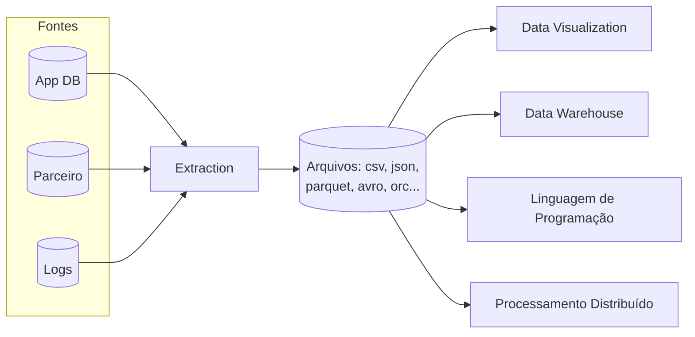
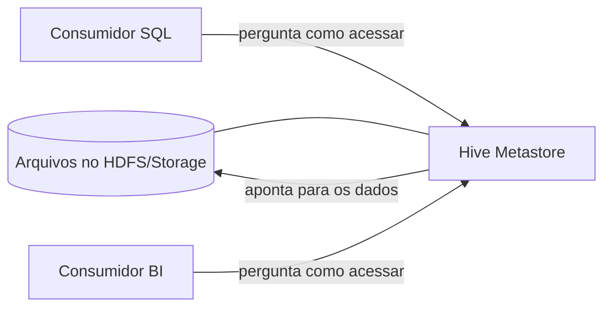

# Aula 1 — Catálogo de Dados

Do Hive Metastore ao AWS Glue Data Catalog

<!--
Aula 1 da GDBD. Origem: slides 1-60 do deck Google Slides.
Narrativa: estudo de caso -> open source -> trazendo para AWS -> serviço
gerenciado -> prós/contras -> prática. Ver .kiro/steering/didatica.md.

PONTUALIDADE: esta é a aula 1. Avise a turma que as aulas começam no horário,
com tolerância máxima de 10 minutos. A partir da aula 2, os primeiros 30 min
são para dúvidas e para terminar atividades.
-->

---

## Apresentações

Antes de começar, uma rodada rápida:

- Qual o seu nome?
- De onde você é?
- Com o que você trabalha hoje?
- Qual seu objetivo nesta disciplina?
- Conta uma curiosidade!

---
layout: center
---

## Introdução ao curso

---

## Objetivos do curso

- Introdução aos serviços de Big Data da AWS
- Deep dive em cluster Hadoop na AWS (**EMR**)
- Data Lake na AWS
- Laboratórios práticos

---

## O que você vai levar da Aula 1

Ao final de hoje, você será capaz de:

- Explicar **por que** análises precisam de um **catálogo**, não de arquivos soltos.
- Relacionar **Hive Metastore → AWS Glue Data Catalog** (open source → gerenciado).
- Criar uma **tabela catalogada** à mão e ver **schema evolution** (Lab 01).
- Automatizar a catalogação com o **Glue Crawler** (Lab 02).

---

## Roteiro de hoje (terça · 18h30–22h · ~3h30)

| Tempo | Bloco |
|---|---|
| 0:00–0:15 | Abertura, combinados e **pontualidade** |
| 0:15–0:45 | Estudo de caso: o problema de "arquivos soltos" |
| 0:45–1:20 | Catálogo de dados; Hive Metastore → Glue Data Catalog |
| 1:20–1:45 | O serviço gerenciado: integrações e preço |
| 1:45–2:00 | **Intervalo** |
| 2:00–2:25 | **Lab 01** — tabela catalogada (schema evolution) |
| 2:25–2:40 | "Catalogar à mão não escala" → Crawler |
| 2:40–3:15 | **Lab 02** — Glue Crawler |
| 3:15–3:30 | Fechamento + o que vem na Aula 2 |

<!-- Esta é a 1ª aula: avise que começa 18h30 em ponto (tolerância 10 min). -->

---

## Avaliação

- Presença em sala
- Participação durante os laboratórios práticos
- Trabalho / entrega

<!--
A avaliação é lançada em disciplinas/gdbd/avaliacao/notas/ (CSV versionado)
e a nota final é calculada por `npm run notas`. Não há quiz nesta edição.
-->

---

## Referências

- Big Data Analytics Options on AWS
- Data Engineering with AWS
- Designing Data-Intensive Applications
- Learn Amazon SageMaker
- Storage Best Practices for Data and Analytics Applications
- Data Analytics Lens (AWS Well-Architected)
- AWS Certified Data Analytics Study Guide
- Spark: The Definitive Guide

---
layout: section
---

# Módulo 1

Introdução aos serviços de Big Data na AWS

---

## Estudo de caso

Trabalhamos em um produto **Cloud Native**. Com o tempo, o produto precisa
iniciar suas iniciativas de dados para:

- Apoiar a decisão baseada em dados
- Analisar desempenho comercial
- Analisar o mercado
- Integrar com produtos parceiros

Existem diversas fontes possíveis, com:

- Tamanhos diferentes
- Formatos diferentes
- Schemas de dados diferentes

---
layout: center
---

## O problema central

### Como analisar dados de fontes heterogêneas de forma escalável?

---

## Arquitetura inicial

A extração envia os arquivos **no formato que cada fonte disponibiliza**, e os
consumidores os utilizam de formas diferentes.

---

## Perguntas que essa abordagem levanta

- Como fica o **esquema de dados** nessa abordagem?
- Como controlar as **versões** do esquema?
- É possível garantir que **todos** os sistemas consigam ler **todos** os arquivos?
  - xml, json, xls, csv, parquet, avro, orc, etc.
- O que fazer quando os schemas **mudarem**?
- Como **juntar** dados assim?
- É possível saber **quais dados** o projeto já tem?

<!--
Deixe a turma tentar responder antes de avançar. Essas perguntas motivam o
conceito de catálogo de dados no próximo slide.
-->

---
layout: center
---

## A resposta: Catálogo de Dados

Um catálogo provê **Virtualization**, **Discoverability**,
**Schema Evolution** e **Performance**.

---

## O que um Catálogo de Dados provê

- **Virtualization** — análises em SQL querem **tabelas**, não arquivos. O
  catálogo mantém uma visão estável de tabelas, mesmo que os componentes de
  análise mudem.
- **Discoverability** — ajuda a descobrir quais conjuntos de dados existem;
  guarda metadados como dono e frequência de atualização.
- **Schema Evolution** — registra o esquema dos arquivos ao longo do tempo,
  permitindo ler cada arquivo no esquema correto e monitorar mudanças.
- **Performance** — mapeia os arquivos de cada tabela em **partições**, evitando
  trazer para a memória arquivos desnecessários à consulta.

---

## Catálogo de Dados no mundo open source

**Hive Metastore**

- Fundado em 2010
- Componentes:
  - **Query Engine** — executa o SQL
  - **Metastore** — o catálogo, sobre o HDFS

---

## Atualização da arquitetura com o Metastore

Os consumidores **perguntam ao Hive Metastore** como acessar os dados, em vez de
conhecer os arquivos diretamente.

---
layout: section
---

# Trazendo para o mundo Open Source

Prós e contras

---

## Open Source — Prós

- Apoio da comunidade
- Liberdade de implementação (sem **vendor lock-in**)
- Liberdade de customização
- Dezenas de ferramentas disponíveis

---

## Open Source — Contras

- Dificuldade de implementação
- Dificuldade de suporte
- Monitoramento a nível de infraestrutura (baixo nível)
- **TCO** (Total Cost of Ownership) alto

<!--
TCO = custo total de propriedade: não é só a máquina, é o tempo de equipe para
implementar, manter, monitorar e corrigir. Esse é o gancho para a nuvem.
-->

---
layout: section
---

# Trazendo para o ambiente AWS

---

## Mapeamento mental na AWS

| Necessidade | Open Source | AWS |
|---|---|---|
| Armazenamento de objetos | HDFS | **Amazon S3** |
| Spark serverless | Spark | **AWS Glue** |
| Processamento serverless | — | **AWS Lambda** |
| Data Warehouse | — | **Amazon Redshift** |
| Visualização de dados | — | **Amazon QuickSight** |
| Catálogo de dados | Hive Metastore | **AWS Glue Data Catalog** |

---
layout: center
---

## Hive Metastore → AWS Glue Data Catalog

---

## AWS Glue Data Catalog

- Serviço **gerenciado** equivalente ao Hive Metastore.
- Integração com diversos serviços da AWS:
  - Amazon Athena
  - Amazon EMR
  - AWS Glue

---

## Preço conforme a utilização

- Não é necessário contrato de longo prazo
- Pagamos apenas pelo que utilizamos
- Se aumentarmos o uso, os recursos ficam disponíveis e pagamos por isso

Tabela de preços: https://aws.amazon.com/glue/pricing/

---

## O que vimos até aqui

- Equivalência lógica entre serviços open source e AWS
- O que é um Catálogo de Dados
- Qual é o serviço de catálogo de dados na AWS

### Dúvidas até aqui?

---
layout: center
---

## Intervalo — 15 min

<!-- Na volta: mão na massa nos Labs 01 e 02. -->

---
layout: section
---

# Prática

Lab 01 — AWS Glue Data Catalog

---
routeAlias: lab-1
---

## Prática: AWS Glue Data Catalog

**Problema:** trabalhamos em uma empresa de marketing esportivo fazendo uma
análise sobre o melhor jogador do mundo (FIFA). Precisamos inserir informações
incrementais sobre os melhores jogadores em uma **tabela catalogada**, para uso
posterior por ferramentas de análise e processamento.

**Resultado esperado:** uma tabela catalogada e com versões no Glue Data Catalog.

**Tempo:** 15 min

Instruções versionadas: `labs/lab-01-glue-catalog/`

<!--
Conduza o lab ligando cada passo ao conceito (Virtualization, Schema Evolution).
Rode o dry-run.sh do lab ANTES da aula. Ver .kiro/steering/labs.md.
-->

---

## Considerações

- O que acontece se mapearmos uma tabela de **dezenas** de campos?
- E se tivermos **centenas** de tabelas?
- E se por dia forem inseridas **20 tabelas** — qual o esforço disso?

A catalogação manual não escala. Precisamos de automação.

---
layout: center
---

## AWS Glue Crawler

---

## AWS Glue Crawler

- Criação **automática** de tabelas
- Atualização **automática** de tabelas
- Modelo serverless de cobrança — cobra apenas pelo uso

Tabela de preços: https://aws.amazon.com/glue/pricing/

---

---
routeAlias: lab-2
---

## Prática: AWS Glue Crawler

**Problema:** criar uma automação para criar e atualizar tabelas automaticamente.

**Resultado esperado:** uma tabela criada automaticamente pelo AWS Glue Crawler.

**Tempo:** 30 min

Instruções versionadas: `labs/lab-02-glue-crawler/`

---

## O que você leva da Aula 1

- Um **catálogo** dá a visão estável de **tabelas** sobre arquivos no S3.
- **Hive Metastore → Glue Data Catalog**: o mesmo papel, agora gerenciado.
- Você catalogou **à mão** (Lab 01) e viu por que isso **não escala**.
- O **Crawler** automatiza a catalogação (Lab 02).

### Próxima aula (quinta): **consultar** esse catálogo com SQL (Athena) e
### **particionar** para pagar menos.

<!-- Retome os objetivos do início e confirme um a um. Fim da Aula 1. -->
