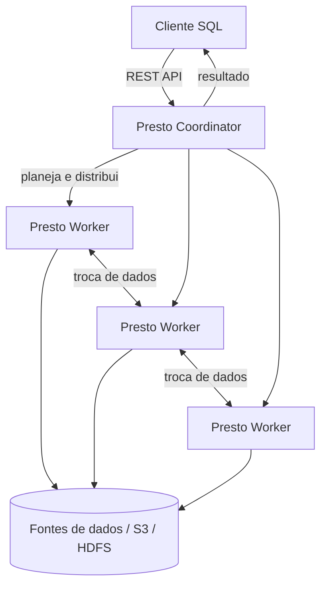
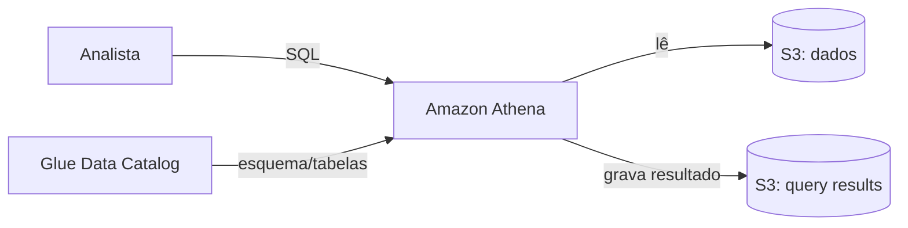
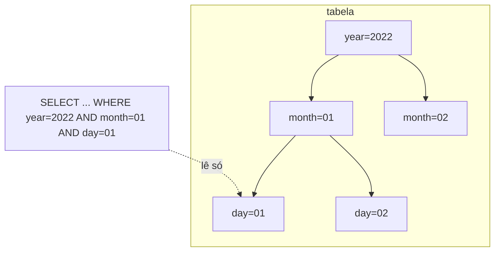

# Aula 2 — Consultando o catálogo com SQL

Do PrestoDB ao Amazon Athena (e particionamento)

<!--
Aula 2 da GDBD. Origem: slides 61-91 do deck Google Slides.
Narrativa: estudo de caso -> open source (Presto) -> trazendo para AWS ->
serviço gerenciado (Athena) -> prós/contras -> prática -> particionamento.
Ver .kiro/steering/didatica.md.

PONTUALIDADE: a partir desta aula, os primeiros 30 minutos são para dúvidas e
para terminar a atividade da aula anterior (Labs 01/02), enquanto os alunos vão
chegando. O conteúdo novo começa DEPOIS desse bloco. Ver plano-de-aula.md.
-->

---

## Primeiros 30 minutos

Enquanto a turma chega:

- Dúvidas da Aula 1 (catálogo, Glue Data Catalog, Crawler)?
- Quem não terminou os **Labs 01 / 02** aproveita agora.
- Confirme que todos têm uma tabela catalogada no Glue — vamos **consultá-la**
  hoje.

<!--
Este bloco trata o feedback de atrasos: ninguém fica para trás e o conteúdo novo
não começa antes da hora. Não avance os slides seguintes antes dos 30 min.
-->

---

## Onde paramos

Na Aula 1 criamos um **catálogo**: tabelas sobre arquivos no S3, com esquema
versionado, catalogadas manualmente (Lab 01) e automaticamente (Lab 02).

Mas catalogar é só metade do caminho. Falta a pergunta óbvia:

### Como eu de fato **consulto** esses dados?

---

## O que você vai levar da Aula 2

Ao final, você será capaz de:

- Relacionar **PrestoDB → Amazon Athena** (consulta SQL distribuída serverless).
- Rodar SQL sobre o catálogo e **ler o "Data scanned"** (o que você paga).
- Explicar **particionamento** e provar que ele **reduz scan, custo e tempo**.
- Decidir entre **Athena** e **Presto no EMR**.

---

## Roteiro de hoje (quinta · 18h30–22h · ~3h30)

| Tempo | Bloco |
|---|---|
| 0:00–0:30 | Chegada: dúvidas da Aula 1 / terminar Labs 01–02 |
| 0:30–1:00 | Estudo de caso + PrestoDB (open source) |
| 1:00–1:30 | Amazon Athena: serverless, catálogo, preço por TB |
| 1:30–2:00 | **Lab 03** — queries no Athena |
| 2:00–2:15 | **Intervalo** |
| 2:15–2:45 | Particionamento: por que corta custo e tempo |
| 2:45–3:20 | **Lab 04** — particionamento |
| 3:20–3:30 | Fechamento + o que vem na Aula 3 |

> **Gestão de tempo (2 labs em 3h30):** priorize o **Lab 03** completo (é o que
> prova "SQL serverless sobre o catálogo"). No **Lab 04**, o essencial é criar a
> tabela particionada e rodar **uma** consulta com filtro; a **comparação de
> "Data scanned" com/sem partição** pode ser demonstração sua se o tempo apertar.
> Os 30 min de chegada são reais — comece a teoria só às 0:30.

---

## Estudo de caso

Somos uma empresa de marketing esportivo. Com a tabela catalogada, o negócio
quer **respostas**, não arquivos:

- Quais os 10 jogadores que mais ganharam o prêmio de melhor do mundo (FIFA)?
- Qual país tem mais ganhadores? Quantos prêmios cada um tem?
- Qual equipe marcou mais gols na Premier League (18/19)?
- Qual time teve a pior defesa? Qual jogo teve a maior goleada?

Queremos responder isso com **SQL**, sem subir servidor nenhum.

---

## O problema central

### Como rodar SQL sobre arquivos no S3, de forma distribuída e escalável?

Os dados podem ser grandes demais para uma única máquina. Precisamos de um motor
que **distribua** a consulta por várias máquinas — e, de preferência, sem termos
de administrar essas máquinas.

---
layout: section
---

# Mundo open source

PrestoDB

---

## PrestoDB

> "Presto é um sistema distribuído que roda em um cluster de máquinas. Permite
> análise em grandes volumes de dados e consulta usando SQL ANSI."

- Roda em um **cluster** de máquinas "baratas" trabalhando juntas.
- Análise **distribuída** sobre grandes volumes.
- SQL ANSI — ninguém precisa aprender uma linguagem nova.

<!--
Origem open source: Presto nasceu no Facebook. É o motor de consulta; o catálogo
(Aula 1) continua sendo o Hive Metastore. Um completa o outro.
-->

---

## Arquitetura do PrestoDB



- **Coordinator**: planeja a consulta e devolve o resultado ao cliente (1 por cluster).
- **Workers**: executam os pedaços da consulta, leem as fontes e trocam dados entre si.

---

## Coordinator e Workers

**Coordinator**
- Planejamento das consultas; comunicação via REST API.
- Em produção, roda em máquina dedicada.
- 1 Coordinator, 1 ou mais Workers.

**Worker**
- Processa os pedaços da consulta indicados pelo Coordinator.
- Recupera os dados das fontes e troca dados com outros Workers.
- Se registra no Coordinator, à disposição para executar.

---
layout: section
---

# Trazendo para a AWS

Três formas de rodar SQL distribuído

---

## Opção 1 — Presto em EC2 "na mão"

- Subir instâncias EC2 e configurar o Presto você mesmo.
- Custo de AWS baixo, mas **custo de implementação e monitoramento alto**.

### Na prática: não é utilizado.

---

## Opção 2 — Presto dentro do Amazon EMR

- O EMR sobe um cluster com Presto já configurado.
- Custo de AWS médio; implementação e monitoramento médios.

### Algumas empresas usam — veremos EMR em detalhe mais adiante.

---

## Opção 3 — Amazon Athena

- Serviço **totalmente gerenciado**: você não vê servidor nenhum.
- Custo de AWS **apenas pelo que escanear**.
- Custo de implementação e monitoramento **baixo**.
- Preço: **US$ 5 por TB escaneado**.

### É a opção mais utilizada.

<!--
Guarde o "US$ 5 por TB escaneado": é o gancho direto para particionamento no fim
da aula — menos dados escaneados = consulta mais barata E mais rápida.
-->

---
layout: center
---

## PrestoDB → Amazon Athena

O mesmo motor de consulta (Presto/Trino), só que **serverless**.

---

## Amazon Athena

- Serviço de **consulta distribuída em SQL**, serverless, baseado em Presto/Trino.
- Lê direto do **S3** e usa o **Glue Data Catalog** como catálogo (o da Aula 1!).
- Precisa de **dois lugares no S3**:
  - **Bucket de dados** — onde estão os arquivos das tabelas.
  - **Bucket de query results** — onde o Athena grava o resultado das consultas.



---

## Presto no EMR vs Amazon Athena

| | Presto no EMR | Amazon Athena |
|---|---|---|
| Custo | Fixo (mesmo parado) | Pay as you go |
| Infraestrutura | Você mantém | Zero |
| Subir no ar | Demora mais | Rápido |
| Escala / resiliência | Sua preocupação | Da AWS |
| Consultas longas (>30 min) | Melhor | Pior |
| Vendor lock-in | Menor | Maior |

Regra prática: consultas **ad hoc e curtas (<30 min)** → Athena. Cluster
permanente com consultas longas e reaproveitamento → considerar EMR.

---
layout: section
---

# Prática

Lab 03 — Rodando queries no Amazon Athena

---

---
routeAlias: lab-3
---

## Prática: queries no Athena

**Problema:** responder as perguntas de negócio sobre os dados catalogados no
Lab 01/02, usando SQL no Athena:

- Top 10 jogadores com mais prêmios da FIFA.
- País com mais ganhadores (e quantos prêmios cada um).
- Premier League 18/19: mais gols, pior defesa, maior goleada.

**Resultado esperado:** executar as consultas SQL sobre os arquivos do catálogo.

**Tempo:** 45 min

Instruções versionadas: `labs/lab-03-athena-queries/`

<!--
Ligue cada query ao conceito: o Athena usa o Glue Data Catalog (Aula 1) para
saber onde estão os dados. Rode o dry-run.sh do lab ANTES da aula.
-->

---
layout: center
---

## Intervalo — 15 min

---
layout: section
---

# Particionamento

Pagando menos e consultando mais rápido

---

## O gancho: US$ 5 por TB escaneado

O Athena cobra pelo volume **escaneado**. Se toda consulta lê a tabela inteira,
você paga pela tabela inteira — toda vez.

### E se a consulta pudesse ler só o pedaço que importa?

É isso que o **particionamento** faz.

---

## Tabela particionada

Em vez de uma pasta única com todos os arquivos, organizamos os dados em
**subpastas por coluna de partição** (ex.: ano, mês, dia):

```text
s3://bucket/tabela/year=2022/month=07/day=01/file.csv
s3://bucket/tabela/year=2022/month=08/day=01/file.csv
```

O nome da pasta (`year=2022`) vira uma **coluna** na tabela. Filtrar por ela faz
o Athena ler **só as pastas correspondentes**.

---

## Particionamento no S3 — visualizando o scan



- Consulta por **janeiro** → lê só `month=01`.
- Consulta pelo **1º de janeiro** → lê só `month=01/day=01`.
- Menos dados escaneados = **mais barato e mais rápido**.

---

## Implementando no S3

1. Suba os arquivos no S3 já no formato particionado:
   - `s3://.../tabela/year=2022/month=07/day=01/file.csv`
   - `s3://.../tabela/year=2022/month=08/day=01/file.csv`
2. Crie um **Crawler** apontando para a **raiz** da tabela (`s3://.../tabela/`).
3. O Crawler detecta `year`, `month`, `day` como **colunas de partição**.
4. Consulte no Athena **filtrando pelas colunas de partição** e observe o scan
   cair.

<!--
É a mesma mecânica do Lab 02 (Crawler), agora com a pasta estruturada em
partições. O "porquê" é o custo por TB escaneado.
-->

---

---
routeAlias: lab-4
---

## Prática: particionando

**Problema:** reorganizar os dados em partições (até o nível de ano) e provar que
consultas filtrando a partição **escaneiam menos dados**.

**Resultado esperado:** consultas que usam a partição no `WHERE` escaneiam menos
dados (compare o "Data scanned" no Athena, com e sem filtro).

**Tempo:** 45 min

Instruções versionadas: `labs/lab-04-particionamento/`

---

## O que você leva da Aula 2

- **Open source → AWS:** PrestoDB → **Amazon Athena** (mesmo motor, serverless).
- O Athena reusa o **Glue Data Catalog** da Aula 1: catálogo e consulta se encaixam.
- **Particionamento** ataca direto o custo por TB escaneado: menos scan, menos
  custo, mais velocidade.

### Próxima aula (sábado, 8h): **processar/transformar** os dados com
### AWS Glue Job (Spark serverless).

<!-- Retome os objetivos do início. Fim da Aula 2. -->
