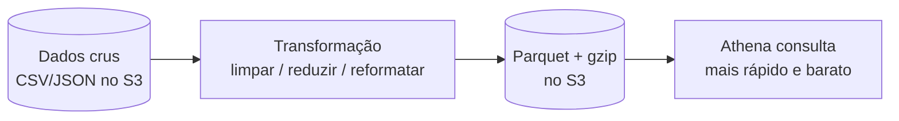

# Aula 3 — Processamento de dados

Spark serverless com AWS Glue Job

<!--
Aula 3 da GDBD. Origem: slides 92-105 do deck Google Slides.
Narrativa: problema (transformar dados) -> opções de processamento na AWS ->
Spark (open source) -> AWS Glue Job (Spark serverless) -> DPU/preço ->
quando NÃO usar Spark -> prática -> fechamento. Ver .kiro/steering/didatica.md.

PONTUALIDADE: primeiros 30 min para dúvidas / terminar os Labs 03 e 04,
enquanto os alunos chegam. Conteúdo novo começa depois. Ver plano-de-aula.md.
-->

---

## Primeiros 30 minutos

Enquanto a turma chega:

- Dúvidas da Aula 2 (Athena, particionamento)?
- Quem não terminou os **Labs 03 / 04** aproveita agora.
- Confirme que todos conseguiram comparar o **"Data scanned"** com e sem
  filtro de partição — é a ponte para a aula de hoje.

<!-- Não avance antes dos 30 min. Trata o feedback de atrasos. -->

---

## Onde paramos

Até agora **catalogamos** (Aula 1) e **consultamos** (Aula 2) dados que já
estavam no formato certo. Mas dado cru raramente chega pronto:

- Colunas demais, nomes ruins, tipos errados.
- Formato pesado para consulta (CSV/JSON linha a linha).
- Vários arquivos que precisam ser juntados, limpos, reduzidos.

### Falta uma etapa: **transformar** o dado (ETL).

---

## Estudo de caso

Temos os jogos da Premier League (18/19) em CSV, com dezenas de colunas. O
negócio quer um dataset **enxuto e rápido de consultar**:

- Manter só `Date, HomeTeam, AwayTeam, FTHG, FTAG`.
- Salvar em **Parquet com compressão gzip** (colunar, leve, barato de escanear).
- E então responder: quantos jogos por ano? Qual mês teve mais/menos jogos?

### Como rodar essa transformação de forma distribuída e escalável?

---

## O problema central

Transformar grandes volumes não cabe numa única máquina nem num script simples.
Precisamos de **processamento distribuído** — e, de preferência, sem administrar
cluster.



---
layout: section
---

# Opções de processamento na AWS

Do mais simples ao mais pesado

---

## Quatro formas de processar dados

| Serviço | Linguagem/motor | Quando |
|---|---|---|
| **AWS Lambda** | Python | tarefas curtas, event-driven, sem estado pesado |
| **ECS Fargate / EC2** | Python (contêiner) | processo longo, controle do ambiente |
| **AWS Glue** | **Spark** | ETL distribuído serverless |
| **Amazon EMR** | Spark / Hadoop | cluster gerenciado, cargas grandes/contínuas |

Hoje focamos no **AWS Glue** (Spark serverless). EMR vem na próxima aula.

---
layout: section
---

# Mundo open source

Apache Spark

---

## Apache Spark

- Motor de **processamento distribuído** em memória, padrão de mercado para ETL
  e análise de grandes volumes.
- Divide o trabalho entre vários executores que processam partições dos dados em
  paralelo.
- APIs em Scala, Java, **Python (PySpark)** e SQL.

No mundo open source, você sobe e administra o cluster Spark (Hadoop/YARN,
dimensionamento, resiliência). É poderoso, mas o **TCO** é alto — o mesmo gancho
da Aula 1.

---
layout: section
---

# Trazendo para a AWS

AWS Glue Job

---

## AWS Glue — Spark serverless

- É como um **AWS Lambda para Spark**: você entrega o job, a AWS roda.
- **Pay as you go** — sem cluster ligado parado.
- Escreve jobs em **PySpark/Scala** ou gera por **interface visual (low-code)**.
- Mesmo serviço que hospeda o **Data Catalog** e o **Crawler** das aulas anteriores.

<!--
Amarre: o Glue já apareceu como catálogo (Aula 1). Aqui é a face de
processamento do mesmo serviço. Reduz carga cognitiva.
-->

---

## Unidade de cobrança: DPU

Glue cobra por **DPU** (Data Processing Unit):

- 1 DPU ≈ **4 vCPU e 16 GB** de memória.
- Mínimo **2 DPU**, máximo **100 DPU**, padrão **5 DPU**.
- Você paga por **DPU-hora** enquanto o job roda.

---

## Preço na prática

Exemplo: um job de **15 minutos** usando **6 DPUs**.

```text
6 DPUs  ×  1/4 de hora  ×  US$ 0,44/DPU-hora  ≈  US$ 0,66
```

Pouco mais de **meio dólar** por uma transformação pesada e distribuída — sem
subir nem manter cluster nenhum.

<div class="text-sm opacity-70 mt-6">
Tabela de preços: https://aws.amazon.com/glue/pricing/
</div>

---
layout: center
---

## O Glue com Spark é ideal para **todo** processamento na AWS?

Nem sempre. Spark tem custo de inicialização e brilha no distribuído — mas nem
toda carga precisa disso.

---

## Nem tudo precisa de Spark

- Caso real: **Nielsen processa 55 TB por dia com AWS Lambda** — sem Spark.
- Para tarefas curtas, event-driven e paralelizáveis em pedaços pequenos, o
  Lambda pode ser **mais simples e mais barato**.
- Regra prática:
  - Transformação distribuída, joins grandes, muitos GB/TB por job → **Glue/Spark**.
  - Pedaços pequenos, por evento, sem estado pesado → **Lambda**.

<!--
A lição é escolher a ferramenta pelo formato da carga, não por moda. Isso
conecta de volta à tabela das "quatro formas de processar".
-->

---
layout: section
---

# Prática

Lab 05 — Spark serverless com AWS Glue Job

---

## Prática: Spark serverless

**Problema:** transformar os dados da Premier League (18/19):

- Manter só `Date, HomeTeam, AwayTeam, FTHG, FTAG`.
- Salvar em **Parquet + gzip**.
- Responder: quantos jogos por ano? Qual mês teve mais/menos jogos (via Athena)?

**Resultado esperado:** executar consultas no Athena sobre o **arquivo
transformado** (Parquet), mais rápido e barato que sobre o CSV cru.

**Tempo:** 45 min

Instruções versionadas: `labs/lab-05-glue-spark/`

<!--
Ligue ao conceito: Parquet (colunar) + partição reduz o "Data scanned" da
Aula 2. Rode o dry-run.sh do lab ANTES da aula.
-->

---

## Fechamento

- **Open source → AWS:** Apache Spark → **AWS Glue Job** (Spark serverless).
- Cobrança por **DPU-hora**: ETL distribuído por centavos, sem cluster parado.
- **Escolha a ferramenta pela carga:** Spark para distribuído pesado; Lambda
  para pedaços curtos (Nielsen: 55 TB/dia sem Spark).
- Transformar para **Parquet** fecha o ciclo com a Aula 2: consulta mais barata.

### Dúvidas?

<!-- Fim da Aula 3. Próxima: orquestração (Airflow / Step Functions). -->
