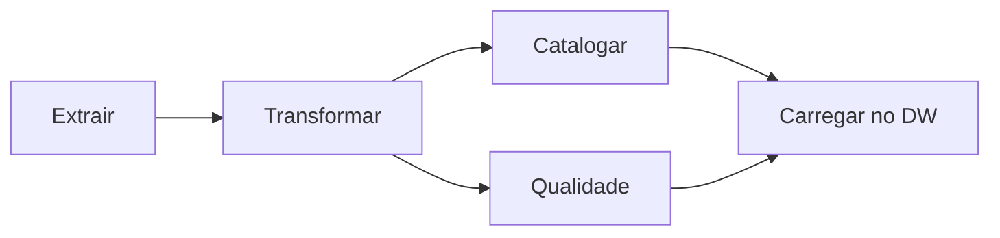
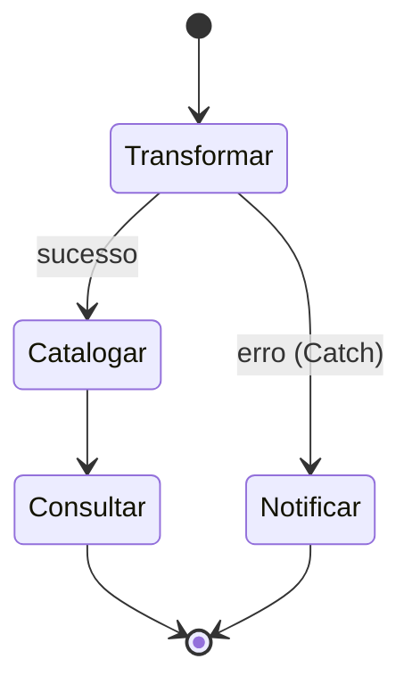

# Aula 4 — Orquestração

Do Apache Airflow ao AWS Step Functions

<!--
Aula 4 da GDBD. Origem: slides 106-122 do deck Google Slides.
Narrativa: problema (coordenar pipelines) -> DAG / Apache Airflow (open source)
-> trazendo para AWS (MWAA e Step Functions) -> prós/contras -> fechamento.
Ver .kiro/steering/didatica.md.

PONTUALIDADE: primeiros 30 min para dúvidas / terminar o Lab 05, enquanto os
alunos chegam. Conteúdo novo começa depois. Ver plano-de-aula.md.
-->

---

## Primeiros 30 minutos

Enquanto a turma chega:

- Dúvidas da Aula 3 (Glue Job, Spark, DPU, Parquet)?
- Quem não terminou o **Lab 05** aproveita agora.
- Lembrete: o Lab 05 tinha **custo** — confirme que todos fizeram a limpeza.

<!-- Não avance antes dos 30 min. -->

---

## Onde paramos

Já temos as peças: **catalogar** (Aula 1), **consultar** (Aula 2) e
**transformar** (Aula 3). Mas na vida real essas etapas não rodam soltas — elas
formam um **pipeline**:

```text
extrair → transformar (Glue) → catalogar (Crawler) → consultar (Athena)
```

### Quem dispara cada etapa, na ordem certa, e trata as falhas?

---

## O que você vai levar da Aula 4

Ao final, você será capaz de:

- Explicar **orquestração** e por que **tratar falhas** é o ponto central.
- Modelar um pipeline como **DAG** (Airflow) e como **máquina de estados** (Step Functions).
- Ler e escrever uma state machine em **ASL** com **Task, Choice, Parallel, Map**
  e, principalmente, **Retry/Catch**.
- Escolher entre **MWAA × Step Functions** e entre **Standard × Express**.

---

## Roteiro de hoje (Semana 2 · terça · 18h30–22h · ~3h30)

| Tempo | Bloco |
|---|---|
| 0:00–0:30 | Chegada: dúvidas da Aula 3 / limpeza do Lab 05 |
| 0:30–1:00 | O problema: pipelines, dependências e **falhas** |
| 1:00–1:30 | DAG + Apache Airflow (open source) |
| 1:30–1:45 | **Intervalo** |
| 1:45–2:20 | Step Functions: máquina de estados e **ASL** |
| 2:20–2:50 | Tipos de estado + **Retry/Catch** (o coração da aula) |
| 2:50–3:20 | **Atividade guiada**: desenhar a state machine do nosso pipeline |
| 3:20–3:30 | MWAA × Step Functions, Standard × Express, fechamento |

---

## O problema central

- O passo B só pode rodar **depois** que o A terminou com sucesso.
- Se o A falhar, o B **não** deve rodar — e alguém precisa ser avisado.
- Alguns passos rodam em **paralelo**, outros convergem.
- Tudo isso precisa acontecer **no horário**, todo dia, sem alguém clicando.

### Isso é **orquestração**: coordenação automatizada de processos.

---
layout: section
---

# Mundo open source

Apache Airflow

---

## DAG — a ideia central

Um pipeline é modelado como um **DAG** (Directed Acyclic Graph / grafo acíclico
dirigido):

- **Dirigido**: cada tarefa aponta para a(s) próxima(s).
- **Acíclico**: não há volta/loop — o fluxo sempre avança.



Usos típicos: pipeline de **ETL**, pipeline de **Machine Learning**, fluxos
complexos de deploy.

---

## Apache Airflow

Orquestrador open source que define DAGs em **Python** e os agenda/monitora.

Componentes da arquitetura:

- **Scheduler** — agenda os workflows e submete as tarefas.
- **Executor** — manipula as tarefas em execução.
- **Workers** — executam as tasks.
- **Webserver** — interface web para o usuário.
- **DAG Directory** — onde ficam os DAGs.
- **Metadata Database** — armazena os estados.

---

## Airflow: DAG em código

O pipeline é **código versionável** — a mesma filosofia deste repositório.

```python
with DAG("pipeline_premier", schedule="@daily", start_date=...) as dag:
    extrair   = PythonOperator(task_id="extrair",   python_callable=extrai)
    transformar = PythonOperator(task_id="transformar", python_callable=transforma)
    catalogar = PythonOperator(task_id="catalogar", python_callable=cataloga)

    extrair >> transformar >> catalogar  # define as dependências
```

<div class="text-sm opacity-70 mt-4">
Referência: https://airflow.apache.org/docs/apache-airflow/stable/tutorial.html
</div>

---
layout: section
---

# Trazendo para a AWS

Duas opções

---

## Opção 1 — Amazon MWAA

**Managed Workflows for Apache Airflow**

- É o **próprio Airflow**, gerenciado pela AWS.
- Funciona como o Amazon RDS faz para um banco: você usa, a AWS opera.
- **Ideal para migrar** Airflows existentes para a nuvem com pouco atrito.
- Cobrança **por hora** (modelo parecido com o RDS — há ambiente ligado).

<div class="text-sm opacity-70 mt-4">
Preço: https://aws.amazon.com/managed-workflows-for-apache-airflow/pricing/
</div>

---
layout: section
---

# Opção 2 — AWS Step Functions

A fundo: como a máquina de estados funciona

---

## De DAG para máquina de estados

O Airflow pensa em **DAG de tarefas**. O Step Functions pensa em **máquina de
estados**: o fluxo é uma sequência de **states**, cada um faz uma coisa e decide
o próximo.



- **Serverless**, pay as you go, sem ambiente ligado.
- Integra **nativamente** com Glue, Lambda, EMR, Athena, SNS… (200+ serviços).
- Interface **visual** (Workflow Studio) que gera/edita o fluxo.

---

## ASL — a máquina de estados é JSON

O fluxo é descrito em **Amazon States Language** (JSON). Cada chave em `States`
é um estado; `Next` liga um ao outro; `End` encerra.

```json
{
  "Comment": "Pipeline da Premier League",
  "StartAt": "TransformarGlue",
  "States": {
    "TransformarGlue": {
      "Type": "Task",
      "Resource": "arn:aws:states:::glue:startJobRun.sync",
      "Parameters": { "JobName": "lab05-transforma-premier" },
      "Next": "RodarCrawler"
    },
    "RodarCrawler": { "Type": "Task", "Resource": "...", "Next": "Sucesso" },
    "Sucesso": { "Type": "Succeed" }
  }
}
```

> Repare no `.sync`: o Step Functions **espera o Glue Job terminar** antes de
> seguir. É a dependência "B depois de A" declarada de forma explícita.

---

## Tipos de estado (o vocabulário)

| Estado | Para quê |
|---|---|
| **Task** | faz o trabalho (chama Glue, Lambda, EMR, Athena…) |
| **Choice** | ramifica conforme uma condição (if/else) |
| **Parallel** | roda vários ramos **ao mesmo tempo** |
| **Map** | repete um fluxo para **cada item** de uma lista |
| **Wait** | espera um tempo / até um horário |
| **Succeed / Fail** | encerra com sucesso ou erro |

Com esses blocos você monta qualquer pipeline — sem escrever o "cola" entre os
serviços.

---

## O coração da aula: Retry e Catch

Orquestração séria é **sobre o que fazer quando falha**. No Step Functions isso
é declarativo, por estado:

```json
"TransformarGlue": {
  "Type": "Task",
  "Resource": "arn:aws:states:::glue:startJobRun.sync",
  "Parameters": { "JobName": "lab05-transforma-premier" },
  "Retry": [
    { "ErrorEquals": ["States.ALL"], "MaxAttempts": 2, "BackoffRate": 2.0, "IntervalSeconds": 10 }
  ],
  "Catch": [
    { "ErrorEquals": ["States.ALL"], "Next": "NotificarFalha" }
  ],
  "Next": "RodarCrawler"
}
```

- **Retry**: tenta de novo (com *backoff*) antes de desistir — resolve falha transitória.
- **Catch**: se esgotar, **desvia** para tratar o erro (ex.: notificar via SNS).

### É isto que, no Airflow, você teria que codar na mão.

---

## Standard vs Express

Dois tipos de workflow — a escolha é de **duração e volume**:

| | **Standard** | **Express** |
|---|---|---|
| Duração | até **1 ano** | até **5 min** |
| Cobrança | por **transição de estado** | por nº de execuções + duração |
| Garantia | exactly-once | at-least-once |
| Bom para | pipelines de ETL/dados (nosso caso) | alto volume, eventos curtos |

Para orquestrar um ETL diário (Glue → Crawler → Athena), use **Standard**.

---
layout: section
---

# Atividade guiada (em classe)

Desenhar a máquina de estados do nosso pipeline

---

## Mão na massa — sem custo

Vamos **modelar juntos**, no Workflow Studio (console) ou no papel, a state
machine do pipeline que já construímos nas aulas anteriores:

1. **Task** `TransformarGlue` (`glue:startJobRun.sync`) — com **Retry** (2x).
2. **Task** `RodarCrawler` — **Catch** → `NotificarFalha` (SNS).
3. **Choice**: achou tabela nova? → segue; senão → `Wait` e reavalia.
4. **Task** `ConsultarAthena` → **Succeed**.

> Desafio em duplas: escreva o **ASL** dos estados 1 e 2 com `Retry`/`Catch`.
> Depois comparamos as soluções.

<!--
Esta atividade preenche ~30 min de forma ativa, sem criar recurso pago. Peça que
desenhem no Workflow Studio (não precisa executar) ou no quadro. Discuta erros
comuns: esquecer o .sync, não tratar Catch, Retry sem backoff.
-->

---
layout: center
---

## Apache Airflow (MWAA) ou AWS Step Functions?

| | MWAA (Airflow) | Step Functions |
|---|---|---|
| Modelo | Ambiente gerenciado (por hora) | Serverless (pay as you go) |
| Define o fluxo | Python (DAG) | ASL (JSON) / Workflow Studio |
| Portabilidade | Airflow padrão (menos lock-in) | Específico da AWS |
| Melhor para | Migrar Airflow; DAGs complexos em Python | Nascer na AWS; integração nativa |
| Operação | Menos que self-hosted, mas há ambiente | Praticamente zero |

---

## O que você leva da Aula 4

- **Orquestração é sobre dependências e falhas**, não só "rodar na ordem".
- **DAG** (Airflow) e **máquina de estados** (Step Functions) resolvem o mesmo
  problema com modelos diferentes.
- No Step Functions, **Retry/Catch** tornam o tratamento de erro **declarativo**.
- Escolha: migrar Airflow → **MWAA**; nascer na AWS → **Step Functions**
  (**Standard** para ETL).

### Próxima aula (quinta): **Amazon EMR** — o motor pesado (Hadoop/Spark
### gerenciado). Atenção: lab com custo (~US$ 1) e dry-run reforçado.

<!-- Retome os objetivos do início. Fim da Aula 4. -->
