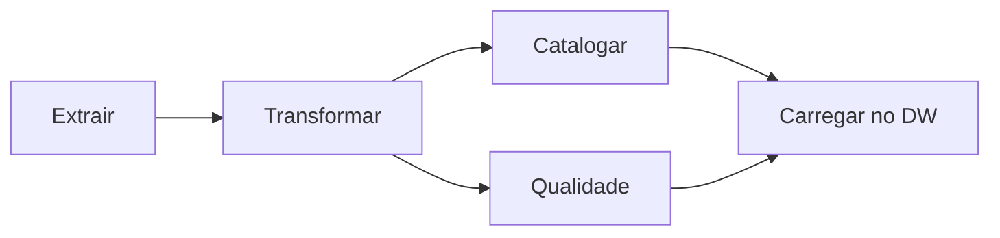
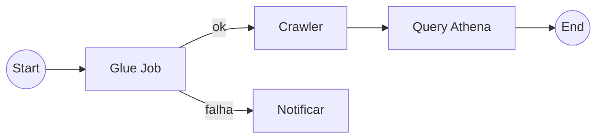

# Aula 4 — Orquestração

Do Apache Airflow ao AWS Step Functions

<!--
Aula 4 da GDBD. Origem: slides 106-122 do deck Google Slides.
Narrativa: problema (coordenar pipelines) -> DAG / Apache Airflow (open source)
-> trazendo para AWS (MWAA e Step Functions) -> prós/contras -> fechamento.
Ver .kiro/steering/didatica.md.

PONTUALIDADE: primeiros 30 min para dúvidas / terminar o Lab 05, enquanto os
alunos chegam. Conteúdo novo começa depois. Ver plano-de-aula.md.
-->

---

## Primeiros 30 minutos

Enquanto a turma chega:

- Dúvidas da Aula 3 (Glue Job, Spark, DPU, Parquet)?
- Quem não terminou o **Lab 05** aproveita agora.
- Lembrete: o Lab 05 tinha **custo** — confirme que todos fizeram a limpeza.

<!-- Não avance antes dos 30 min. -->

---

## Onde paramos

Já temos as peças: **catalogar** (Aula 1), **consultar** (Aula 2) e
**transformar** (Aula 3). Mas na vida real essas etapas não rodam soltas — elas
formam um **pipeline**:

```text
extrair → transformar (Glue) → catalogar (Crawler) → consultar (Athena)
```

### Quem dispara cada etapa, na ordem certa, e trata as falhas?

---

## O problema central

- O passo B só pode rodar **depois** que o A terminou com sucesso.
- Se o A falhar, o B **não** deve rodar — e alguém precisa ser avisado.
- Alguns passos rodam em **paralelo**, outros convergem.
- Tudo isso precisa acontecer **no horário**, todo dia, sem alguém clicando.

### Isso é **orquestração**: coordenação automatizada de processos.

---
layout: section
---

# Mundo open source

Apache Airflow

---

## DAG — a ideia central

Um pipeline é modelado como um **DAG** (Directed Acyclic Graph / grafo acíclico
dirigido):

- **Dirigido**: cada tarefa aponta para a(s) próxima(s).
- **Acíclico**: não há volta/loop — o fluxo sempre avança.



Usos típicos: pipeline de **ETL**, pipeline de **Machine Learning**, fluxos
complexos de deploy.

---

## Apache Airflow

Orquestrador open source que define DAGs em **Python** e os agenda/monitora.

Componentes da arquitetura:

- **Scheduler** — agenda os workflows e submete as tarefas.
- **Executor** — manipula as tarefas em execução.
- **Workers** — executam as tasks.
- **Webserver** — interface web para o usuário.
- **DAG Directory** — onde ficam os DAGs.
- **Metadata Database** — armazena os estados.

---

## Airflow: DAG em código

O pipeline é **código versionável** — a mesma filosofia deste repositório.

```python
with DAG("pipeline_premier", schedule="@daily", start_date=...) as dag:
    extrair   = PythonOperator(task_id="extrair",   python_callable=extrai)
    transformar = PythonOperator(task_id="transformar", python_callable=transforma)
    catalogar = PythonOperator(task_id="catalogar", python_callable=cataloga)

    extrair >> transformar >> catalogar  # define as dependências
```

<div class="text-sm opacity-70 mt-4">
Referência: https://airflow.apache.org/docs/apache-airflow/stable/tutorial.html
</div>

---
layout: section
---

# Trazendo para a AWS

Duas opções

---

## Opção 1 — Amazon MWAA

**Managed Workflows for Apache Airflow**

- É o **próprio Airflow**, gerenciado pela AWS.
- Funciona como o Amazon RDS faz para um banco: você usa, a AWS opera.
- **Ideal para migrar** Airflows existentes para a nuvem com pouco atrito.
- Cobrança **por hora** (modelo parecido com o RDS — há ambiente ligado).

<div class="text-sm opacity-70 mt-4">
Preço: https://aws.amazon.com/managed-workflows-for-apache-airflow/pricing/
</div>

---

## Opção 2 — AWS Step Functions

**Opção serverless da AWS**

- **Pay as you go** — sem ambiente ligado parado.
- **Escalável** e **integrado** nativamente com os serviços da AWS.
- Interface **visual (low-code)** para montar o fluxo.



---
layout: center
---

## Apache Airflow (MWAA) ou AWS Step Functions?

| | MWAA (Airflow) | Step Functions |
|---|---|---|
| Modelo | Ambiente gerenciado (por hora) | Serverless (pay as you go) |
| Portabilidade | Airflow padrão (menos lock-in) | Específico da AWS |
| Melhor para | Migrar Airflow existente; DAGs complexos | Nascer na AWS; integração nativa |
| Operação | Menos que self-hosted, mas há ambiente | Praticamente zero |

---

## Fechamento

- **Open source → AWS:** Apache Airflow → **MWAA** (o mesmo Airflow gerenciado)
  ou **Step Functions** (serverless, nativo da AWS).
- Pipeline como **DAG**: dependências explícitas, ordem garantida, falhas tratadas.
- Escolha pelo contexto: migração de Airflow → MWAA; nascer na AWS → Step Functions.
- Na próxima aula, o **EMR** entra como motor pesado desses pipelines.

### Dúvidas?

<!-- Fim da Aula 4. Próxima: Amazon EMR (Hadoop/Spark gerenciado). -->
