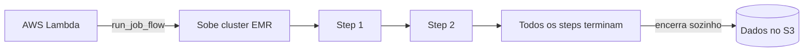

# Aula 5 — Amazon EMR

Hadoop e Spark gerenciados na AWS

<!--
Aula 5 da GDBD. Origem: slides 123-163 do deck Google Slides.
Narrativa: problema (cluster Hadoop/Spark gerenciado) -> EMR -> S3 vs EBS ->
tipos de cluster (long running / transient) -> tipos de nó -> acesso (SSH /
Notebooks) -> boas práticas -> prática. Ver .kiro/steering/didatica.md.

PONTUALIDADE: primeiros 30 min para dúvidas da Aula 4, enquanto chegam.

ATENÇÃO: o lab desta aula TEM custo (~US$ 1) e foi o que falhou em turma
anterior (indisponibilidade de instâncias). Rode o dry-run reforçado ANTES e
tenha o plano B pronto. Ver lab-06 e troubleshooting.
-->

---

## Primeiros 30 minutos

Enquanto a turma chega:

- Dúvidas da Aula 4 (orquestração, DAG, MWAA vs Step Functions)?
- Hoje o lab **tem custo (~US$ 1)** e exige **usuário IAM** (root não conecta
  no EMR Notebooks). Confirme que todos rodaram o `dry-run.sh` reforçado.

<!-- Não avance antes dos 30 min. -->

---

## O que você vai levar da Aula 5

Ao final, você será capaz de:

- Explicar o que é o **EMR** e por que **desacoplar** computação (cluster) de
  armazenamento (S3).
- Escolher entre cluster **transient** e **long running**.
- Identificar os papéis de **Master / Core / Task Node** e usar **Spot**.
- Subir um cluster e rodar um ETL em Spark (Lab 06).

---

## Roteiro de hoje (Semana 2 · quinta · 18h30–22h · ~3h30)

Janela noturna + lab com custo: **gestão de tempo é crítica** aqui.

| Tempo | Bloco |
|---|---|
| 0:00–0:30 | Chegada: dúvidas da Aula 4 + conferir dry-run reforçado |
| 0:30–1:05 | EMR: o que é, S3 vs EBS, tipos de cluster |
| 1:05–1:35 | Tipos de nó, acesso (SSH/Notebooks), boas práticas |
| 1:35–1:50 | **Intervalo** |
| 1:50–3:10 | **Lab 06** — EMR (atenção ao custo e ao plano B) |
| 3:10–3:30 | Fechamento + o que vem na Aula 6 (Data Lake) |

> **Se o cluster não subir rápido, vá para o plano B (demonstração).** A janela
> é curta e o lab é o historicamente problemático — não queime a aula tentando
> provisionar.

---

## O que é o Amazon EMR

**Elastic MapReduce** — cluster **Hadoop gerenciado** pela AWS.

- Roda Spark, Hive, Presto e outros frameworks de Big Data.
- Pode usar o **Amazon S3** como armazenamento de longa duração (via EMRFS):
  mais lento, mas permite **encerrar o cluster sem perder os dados**.
- Usa **Amazon EBS** (SSD) para o trabalho local: mais rápido, menor latência.

---

## Amazon S3 vs Amazon EBS no EMR

| | Amazon S3 (EMRFS) | Amazon EBS |
|---|---|---|
| Papel | Armazenamento persistente | Disco de trabalho do cluster |
| Velocidade | Mais lento | Mais rápido, baixa latência |
| Durabilidade | 11 noves (99.999999999%) | Vida do volume |
| Dado sobrevive ao cluster? | **Sim** | Não |

O padrão moderno: **desacoplar computação e armazenamento** — dados no S3,
cluster efêmero processa e some.

---

## Tipos de cluster

**Long Running** — o cluster fica de pé aceitando jobs; precisa de ação para
desligar.
- Ideal para: trabalho **interativo**, desenvolvimento, jobs muito grandes ou
  muito frequentes (não compensa subir/descer toda hora).

**Transient** — sobe, roda os jobs (steps), e **se encerra sozinho** ao terminar
(ou em erro).
- Ideal para: **economia** (só paga durante a execução), escala por job,
  isolamento de ambiente.

---

## Transient Cluster — arquitetura

Um Lambda chama `run_job_flow`, que sobe o cluster e enfileira os **steps**.
Quando o último step termina, o cluster é **encerrado automaticamente**.

---

## Tipos de nó (máquinas)

- **Master Node** — gerencia o cluster (NameNode e JobTracker do Hadoop).
- **Core Node** — máquinas de trabalho completas: guardam dados no HDFS
  (DataNode) e processam (TaskTracker).
- **Task Node** — só processam (TaskTracker); **não** têm HDFS — ótimos para
  escalar com **Spot Instances**.

---

## Acessando o cluster — SSH

- **Secure Shell**, porta **22**, autenticado por chave (ou usuário/senha).
- Serve para executar comandos remotos no Master Node.
- Exige uma **regra no Security Group** liberando a porta 22 para o seu IP.

<!--
Segurança: libere a porta 22 só para o SEU IP, nunca 0.0.0.0/0. Mencione isso
em aula — é erro comum e risco real.
-->

---

## Acessando o cluster — EMR Notebooks

- Notebooks (estilo Jupyter) conectados ao cluster para desenvolvimento
  **interativo** em Spark.
- **Exige usuário IAM** — o usuário **root não funciona** no passo de conectar
  no EMR Notebooks (lembrete importante para o lab).

---
layout: section
---

# Boas práticas com Amazon EMR

---

## S3 para dados persistentes (EMRFS)

- **EMRFS** deixa os frameworks (Spark, Hive, Presto) lerem/gravarem direto no S3.
- **Desacopla computação e storage** → mais escalável, habilita clusters
  **transientes**.
- Vantagens do S3: **11 noves** de durabilidade, baixo custo, replicação.

---

## Particionamento, arquivos e formato

- **Particionar** melhora a leitura e reduz custo (menos dados escaneados —
  mesma lição da Aula 2).
- **Tamanho de arquivo**: evite arquivos muito pequenos; ~**128 MB** vai bem para
  o Spark (consulte a recomendação do framework).
- **Compressão**: minimiza a transferência S3 → EMR → S3.
- **Formato colunar** (Parquet) para análise.
- **S3 VPC Gateway Endpoint**: evita que o tráfego de dados passe pela internet.

---

## Hardware e escala

- **Auto Scaling**: aumenta a capacidade conforme o uso — economia e menos erros
  por falta de recurso.
- **Spot Instances**: economia de **70–90%**, especialmente em **Task Nodes**.
- Use a **última versão do EMR**: performance, correções, segurança e upgrades
  mais fáceis.

---

## Transient x Long Running — casos de uso

| Transient | Long Running |
|---|---|
| Grandes transformações | Notebooks |
| ETL para DW e Data Lake | Jobs ad-hoc |
| Jobs de Machine Learning | Streaming |

Regra: carga **em lote, previsível e isolada** → Transient. Trabalho
**interativo/contínuo** → Long Running.

---
layout: section
---

# Prática

Lab 06 — EMR workshop (cluster + Spark)

---

## Prática: Amazon EMR

**Problema:** subir um cluster EMR, rodar um ETL em Spark e (extra) orquestrar os
steps com **AWS Step Functions**.

- Setup → criação do cluster → ETL com Spark.
- **Extra/desafio:** orquestrar o EMR com Step Functions.

**Custo aproximado: US$ 1.** Exige **usuário IAM** (root não conecta no Notebook).

**Tempo:** 60 min

Instruções versionadas: `labs/lab-06-emr-workshop/`

<!--
Este é o lab historicamente problemático (instâncias indisponíveis na região).
Rode o dry-run REFORÇADO na véspera e tenha plano B (trocar região / demonstrar).
-->

---

## O que você leva da Aula 5

- **EMR** = Hadoop/Spark gerenciado; desacople **computação (cluster)** de
  **armazenamento (S3)**.
- **Transient** para lote econômico; **Long Running** para interativo.
- Boas práticas repetem a lição do curso: **particionar, formato colunar,
  compressão** — custo e performance andam juntos.

### Próxima aula (sábado, 8h): **Data Lake** — tudo o que vimos vira uma
### arquitetura em camadas (fechamento do curso).

<!-- Retome os objetivos do início. Fim da Aula 5. -->
