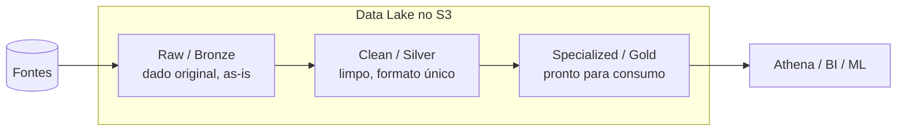

# Aula 6 — Data Lake

Juntando tudo: o repositório central de dados

<!--
Aula 6 (final) da GDBD. Origem: slides 164-179 do deck Google Slides
(rotulados como "Aula 07" no material original).
Narrativa: o que é um Data Lake -> vantagens -> tradicional vs Data Lake ->
boas práticas -> mapeamento para serviços AWS -> arquitetura em camadas ->
lab final. Ver .kiro/steering/didatica.md.

PONTUALIDADE: primeiros 30 min para dúvidas / limpeza do Lab 06 (EMR, que tem
custo), enquanto os alunos chegam.
-->

---

## Primeiros 30 minutos

Enquanto a turma chega:

- Dúvidas da Aula 5 (EMR, transient vs long running, boas práticas)?
- **Confirme a limpeza do Lab 06** — era o lab com custo (~US$ 1).
- Hoje amarramos **tudo** do curso em uma arquitetura só.

<!-- Não avance antes dos 30 min. -->

---

## O que você vai levar da Aula 6

Ao final (e do curso), você será capaz de:

- Definir um **Data Lake** e por que ele substitui o DW tradicional em Big Data.
- Mapear **cada boa prática** de Data Lake para um **serviço AWS** visto no curso.
- Desenhar a arquitetura em **3 camadas** (Raw → Clean → Specialized).
- Construir um Data Lake ponta a ponta (Lab 07 — final).

---

## Roteiro de hoje (Semana 2 · sábado · 8h–13h · ~5h)

Aula final, janela longa: teoria + **lab de fechamento** com calma.

| Tempo | Bloco |
|---|---|
| 0:00–0:30 | Chegada: dúvidas / limpeza do Lab 06 |
| 0:30–1:15 | O que é Data Lake; tradicional × Data Lake |
| 1:15–2:00 | Boas práticas → serviços AWS; arquitetura em camadas |
| 2:00–2:15 | **Intervalo** |
| 2:15–4:15 | **Lab 07** — Data Lake de 3 camadas (lab final) |
| 4:15–4:45 | Limpeza + revisão do mapa do curso |
| 4:45–5:00 | Encerramento e próximos passos |

> **Usando a folga do sábado (5h):** se o **Lab 06 (EMR)** ficou pela metade na
> quinta (lab caro, janela curta), os 30 min de chegada e o início do dia servem
> para fechá-lo aqui. O **Lab 07** tem 2h de janela — tempo para construir as 3
> camadas com calma e revisar, no fim, o **mapa completo do curso**
> (catálogo → consulta → processamento → orquestração → EMR → Data Lake).

---

## O que é um Data Lake

- **Repositório centralizado** de dados — estruturados **e** não-estruturados.
- Armazena os dados **"as-is"** (como chegam, sem transformar antes).
- Permite **analisar direto nos arquivos**.

É o destino natural de tudo que vimos: arquivos no S3, catalogados, consultados,
transformados e orquestrados.

---

## Vantagens de um Data Lake

- **Desacopla armazenamento e computação** (a lição que se repetiu o curso todo).
- Analisa dados **variados**: em formato, em tamanho e em fonte.
- **Reduz a complexidade** dos ETLs.
- **Extensível**: fácil plugar novas tecnologias e bancos na ponta.

---

## Tradicional vs Data Lake

| Abordagem tradicional (DW relacional) | Data Lake |
|---|---|
| Fontes relacionais | Relacional **e** não relacional |
| Esquema definido **antes** (schema on write) | Esquema **na leitura** (schema on read) |
| Alto **CAPEX** (compra de máquina antes) | Baixo custo (desacoplamento, pay as you go) |
| "Vários banquinhos para um bancão" | **Único local**, fonte única de confiança |

> **CAPEX** = gasto de capital: investir em máquina **antes** de começar. O Data
> Lake troca isso por custo sob demanda.

---

## Boas práticas de Data Lake → serviço AWS

| Prática | Serviço AWS |
|---|---|
| Armazenar barato por GB | **Amazon S3** |
| Salvar sempre o dado original | **Amazon S3** |
| Catalogar quando fizer sentido | **AWS Glue Data Catalog** |
| Reprocessar na camada anterior possível | **AWS Step Functions** |
| Engine específica na ponta | Athena, Redshift, DynamoDB, Neptune… |
| Usar só a capacidade exigida | Lambda, Fargate, **EMR** |
| Consulta que lê o dado onde ele está | **Amazon Athena**, Redshift, Presto no EMR |
| Formato por tipo de análise (+ compressão) | S3 (parquet, orc, avro, csv, json) |

### Todo o curso cabe nesta tabela.

---

## Arquitetura em camadas

Um Data Lake básico tem **3 camadas**, cada uma um "andar" de refino:

1. **Raw** — dados originais; fonte única de confiança.
2. **Clean** — transformados e limpos, no formato padrão da organização.
3. **Specialized** — preparados para o consumidor final.

---

## Mais de 3 camadas?

Três camadas é o **ponto de partida**, não um limite:

- Pode haver subcamadas por domínio, por qualidade ou por consumidor.
- O princípio se mantém: **cada camada refina a anterior** e o dado original
  nunca se perde (sempre dá para reprocessar da Raw).

---
layout: section
---

# Prática

Lab Final — Data Lake de 3 camadas

---

---
routeAlias: lab-7
---

## Prática: Data Lake de 3 camadas

**Problema:** construir um Data Lake para os dados da Premier League, com as três
camadas (Raw → Clean → Specialized), usando o que vimos no curso:

- **S3** para as camadas, **Glue/Spark** para transformar entre elas,
  **Crawler + Catalog** para catalogar, **Athena** para consumir.

**Resultado esperado:** uma arquitetura em camadas, catalogada e consultável, que
amarra todas as aulas.

**Tempo:** 60 min

Instruções versionadas: `labs/lab-07-data-lake/`

---

## Fechamento do curso

Percorremos o caminho completo **open source → AWS**:

- Catálogo: Hive Metastore → **Glue Data Catalog**
- Consulta: PrestoDB → **Amazon Athena**
- Processamento: Spark → **AWS Glue Job**
- Orquestração: Airflow → **MWAA / Step Functions**
- Cluster: Hadoop → **Amazon EMR**
- Tudo isso compõe um **Data Lake** no **S3**.

### Obrigado! Dúvidas e próximos passos.

<!-- Fim da GDBD. -->
