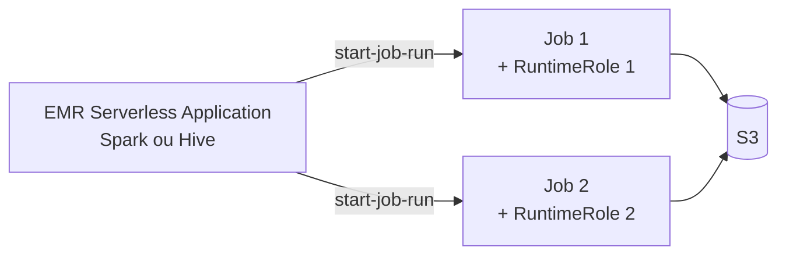

# Aula 1 — Amazon EMR Serverless

PDN · terça · 18h30–22h · ~3h30

<!--
Aula 1 da PDN. Origem: _fonte/pdn_2025_aula1 e pdn_2025_parte1 (slides 2-10).
Refino pedagógico: abertura com objetivos + agenda cronometrada; teoria curta
antes da prática; fechamento com "o que você leva". Ver .kiro/steering/didatica.md.

CONDUÇÃO: é a 1ª aula da PDN — avise que começa 18h30 em ponto (tolerância 10
min). A partir da Aula 2, 30 min iniciais para dúvidas.
-->

---

## O que você vai levar desta aula

Ao final, você será capaz de:

- Explicar **por que** o EMR Serverless existe e o que ele muda frente ao EMR tradicional.
- Desenhar a relação **Application → Job** e o papel da **RuntimeRole por job**.
- Justificar **quando** usar Serverless vs cluster, com argumento de **preço e TCO**.
- Submeter um **job PySpark** (iniciado hoje, aprofundado no sábado).

<!--
Leia os objetivos em voz alta: ancoram a aula. No fim, retomamos cada um.
-->

---

## Roteiro de hoje (3h30)

| Tempo | Bloco |
|---|---|
| 0:00–0:10 | Abertura e combinados |
| 0:10–0:35 | De onde viemos: o peso do EMR tradicional |
| 0:35–1:15 | EMR Serverless: Application, Job, RuntimeRole |
| 1:15–1:35 | Preço e TCO — quando vale |
| 1:35–1:50 | **Intervalo** |
| 1:50–3:20 | **Lab A** — EMR Serverless completo (job + dependências) |
| 3:20–3:30 | Fechamento + o que vem (streaming na quinta) |

<!-- Teoria curta de propósito: dá para fechar o Lab A hoje e aliviar o sábado. -->

---
layout: center
---

## De onde viemos

Na GDBD, subir um **cluster EMR** significava decidir: tipo de cluster, VPC,
roles do cluster, quantas instâncias, quando ligar e desligar.

### Pergunta para abrir: o que desse trabalho é sobre o *dado*, e o que é só
### *infraestrutura*?

<!--
Deixe a turma responder 30s. A resposta — "quase tudo é infra" — motiva o
serverless. Não entregue de imediato.
-->

---

## O problema

O cluster tradicional cobra **enquanto está de pé**, mesmo ocioso, e exige
operação contínua (dimensionar, VPC, resiliência).

Para cargas **intermitentes** — vários times, jobs isolados, picos — isso é caro
e pesado.

### E se a abstração fosse **o job**, não a máquina?

---

## O que é o Amazon EMR Serverless

Opção **serverless** do EMR (lançada em **2022**). Em uma frase:

> Você entrega o **job**; a AWS aloca os recursos, roda e cobra só por isso.

- Abstração por **recurso** (vCPU e RAM), não por instâncias.
- **Sem VPC** obrigatória, sem ligar/desligar cluster.
- Permissão no nível do **job** (RuntimeRole).

---

## Application → Job

Você cria uma **Application** (ambiente Spark ou Hive). Ela sobe capacidade
**sob demanda** quando um job chega e a libera depois.

Sem liga/desliga: você **submete jobs** à Application.

---

## A sacada: RuntimeRole por job

Dois jobs com necessidades diferentes:

- **job 1**: lê a tabela A, escreve na B.
- **job 2**: lê B e C, escreve na D.

| | EMR tradicional | EMR Serverless |
|---|---|---|
| Onde fica a permissão | no **cluster** (todos os jobs juntos) | em cada **job** (RuntimeRole) |
| Resultado | permissão "grande demais" | **menor privilégio** real |

<!--
Este é o ponto conceitual mais forte da aula. Conecte com segurança: menos
blast radius se um job for comprometido.
-->

---

## Preço e TCO — quando vale

- **Preço**: paga vCPU-hora + GB-hora **durante o job**. Ocioso → ~zero.
- **TCO**: sem operar cluster/VPC/escala, cai o custo de **time**, não só de AWS.

**Use Serverless quando:** cargas intermitentes/variáveis, muitos jobs isolados,
times que não querem manter cluster.
**Prefira cluster quando:** uso contínuo e intenso, com reaproveitamento constante.

Leitura: EMR Serverless Review — medium.com/@bernardo.costa/emr-serverless-review-51b659f2ca54

---
layout: center
---

## Intervalo — 15 min

<!-- Retome pontualmente. Na volta: mão na massa no Lab 01. -->

---
layout: section
---

# Prática

Lab A — EMR Serverless (concluímos hoje)

---

---
routeAlias: lab-a
---

## Lab A — EMR Serverless (concluímos hoje)

A teoria foi curta de propósito: temos tempo para **fechar o Lab A hoje** e
deixar o sábado leve.

- Criar a **Application** e a **RuntimeRole**.
- Submeter o **job PySpark** sobre dados reais e ver `SUCCESS`.
- Fazer também o **lab de dependências Python** (empacotar e usar uma lib).

**Timebox hoje:** ~1h20. **Ponto de parada seguro:** job PySpark em `SUCCESS`
(o de dependências pode virar casa, mas tente fechar hoje).

Instruções versionadas: `labs/lab-01-emr-serverless/` · rode o `dry-run.sh` antes.

<!--
A Application criada aqui é reaproveitada no sábado para o Spark do Lab B. Por
isso vale deixá-la pronta e testada hoje.
-->

---

## O que você leva de hoje

- EMR Serverless troca **gerenciar cluster** por **submeter jobs**.
- **RuntimeRole por job** = menor privilégio de verdade.
- A decisão Serverless vs cluster é de **custo e TCO**, não de moda.
- Seu Lab A (EMR Serverless) está **completo** — e a Application será reusada no
  Spark do Lab B, no sábado.

### Próxima aula (quinta): **Machine Learning na AWS com SageMaker**.

<!-- Retome os 4 objetivos do início e confirme um a um com a turma. -->
