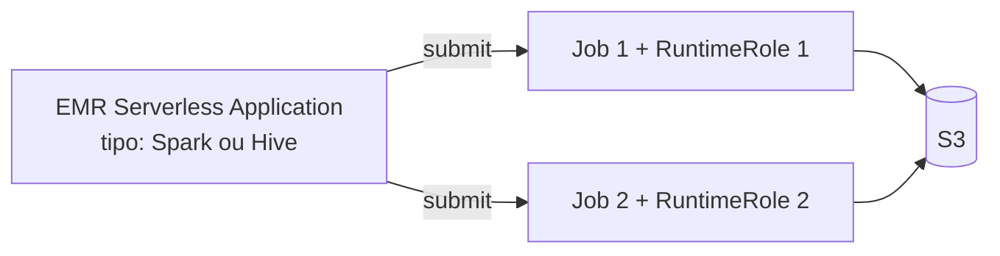

# Aula 1 — Amazon EMR Serverless

A evolução serverless do processamento Spark

<!--
Aula 1 da PDN. Origem: pdn_2025_aula1 / pdn_2025_parte1 (slides 2-10).
Aula de 18h-22h (terça/quinta): teoria + prática mescladas.
Pré-requisito mental: EMR tradicional (visto na GDBD, Aula 5).

PONTUALIDADE: primeira aula da PDN — avise que começa no horário (tolerância
10 min). A partir da aula 2, 30 min iniciais para dúvidas. Ver plano-de-aula.md.
-->

---

## De onde viemos (GDBD)

Na GDBD terminamos com o **Amazon EMR**: cluster Hadoop/Spark gerenciado. Vimos
que era preciso decidir **tipo de cluster**, **VPC**, **roles do cluster** e
dimensionar as instâncias.

### E se nem o cluster a gente precisasse gerenciar?

---

## O que é o Amazon EMR Serverless

Opção **serverless** do EMR, lançada em **2022**.

- Principal vantagem: **ser serverless** — sem provisionar/escalar cluster.
- A abstração passa a ser por **recursos** (vCPU e RAM), não por máquinas.
- **Não precisa de VPC** para rodar.
- **Roles por job**, não por cluster (veremos o impacto disso).

---

## Roles por job (RuntimeRole)

Imagine dois jobs:

- **job 1**: lê a tabela A e escreve na B.
- **job 2**: lê as tabelas B e C e escreve na D.

**No EMR tradicional**, duas perguntas incômodas:
- Que permissão o **cluster** deveria ter?
- Quem **assume** essa permissão (o cluster inteiro)?

**No EMR Serverless**, cada job tem sua **RuntimeRole**:
- `runtime-role-job-1`: lê A, escreve B.
- `runtime-role-job-2`: lê B e C, escreve D.

### Permissão no nível do job = **menor privilégio** de verdade.

---

## Application → Cluster

No EMR Serverless, você cria uma **Application** (um ambiente Spark ou Hive).
Ela sobe capacidade **sob demanda** quando um job chega e a libera depois.

Você não liga/desliga cluster: submete **jobs** à Application.

---

## Submissão de jobs Spark

- Empacote seu script PySpark e submeta como um **job run** na Application.
- Informe a **RuntimeRole** do job e os caminhos de entrada/saída (S3).
- A AWS aloca vCPU/RAM, roda e cobra **só pelo que o job consumiu**.

---

## Comparativo de preço e TCO

- **Preço**: paga pelos recursos (vCPU-hora e GB-hora) **enquanto o job roda** —
  sem cluster ocioso custando.
- **TCO**: além do preço de AWS, cai o custo de **operação** — sem gerenciar
  cluster, VPC, dimensionamento ou resiliência.

### Quando usar
- Cargas intermitentes/variáveis, muitos times submetendo jobs isolados.
- Quem não quer manter cluster de pé nem operar infraestrutura.

<!--
Comparar com o EMR tradicional da GDBD: lá o cluster parado custava e exigia
operação. Aqui o ocioso tende a zero. Esse é o ponto central da aula.
-->

---

## Referências

- Artigo: EMR Serverless Review —
  https://medium.com/@bernardo.costa/emr-serverless-review-51b659f2ca54
- Exemplos oficiais (usados no lab):
  https://github.com/aws-samples/emr-serverless-samples

---
layout: section
---

# Trabalho — Seminário

Avaliação em grupo

---

## Trabalho: Seminário sobre serviços do EMR

- Dividam-se em **grupos**.
- Cada grupo recebe, por **sorteio**, 1 serviço disponível no Amazon EMR.
- Cada grupo prepara uma **apresentação** (crie slides) cobrindo:
  - Para que serve o serviço.
  - A **arquitetura** do serviço.
  - **Concorrentes/alternativas**.
  - **Extra:** implemente um exemplo no serviço.
- Duração: **10–15 minutos** por grupo (respeite o intervalo!).

> A nota do seminário **compõe** com as demais avaliações.

<!--
Este é o componente "trabalho" da avaliação da PDN. Combina com o fluxo de
notas (presença + participação + trabalho) do CSV. Ver avaliacao/.
-->

---

## Prática da aula

**Lab — EMR Serverless** (o detalhamento está na Aula 3, de sábado, dedicada a labs):

- Pré-requisitos primeiro.
- Obrigatório: **EMR Serverless PySpark job**.
- Obrigatório: **Python Dependencies**.
- Extra: **EMR Serverless Hive query**.

Instruções versionadas: `labs/lab-01-emr-serverless/`

---

## Fechamento

- **EMR tradicional → EMR Serverless**: some a gestão de cluster/VPC; a
  abstração vira **recurso (vCPU/RAM)**.
- **RuntimeRole por job**: menor privilégio real.
- Preço e TCO caem para cargas intermitentes (sem cluster ocioso).
- Próxima aula: **Machine Learning na AWS** com o Amazon SageMaker.

### Dúvidas?

<!-- Fim da Aula 1 da PDN. -->
