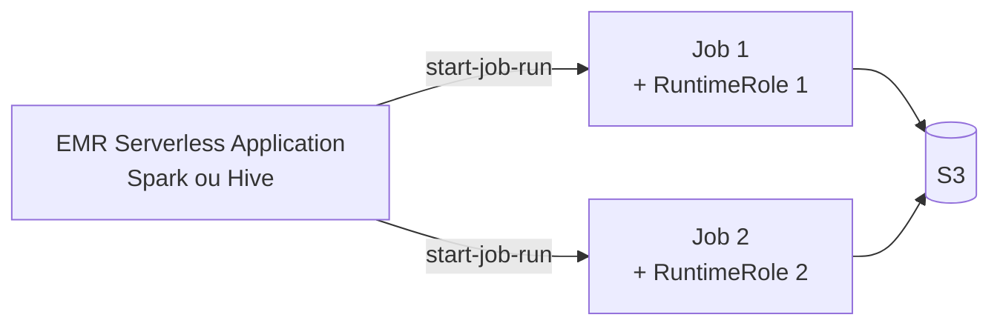

# Aula 1 — Amazon EMR Serverless

PDN · terça · 18h30–22h · ~3h30

<!--
Aula 1 da PDN. Origem: _fonte/pdn_2025_aula1 e pdn_2025_parte1 (slides 2-10).
Refino pedagógico: abertura com objetivos + agenda cronometrada; teoria curta
antes da prática; fechamento com "o que você leva". Ver .kiro/steering/didatica.md.

CONDUÇÃO: é a 1ª aula da PDN — avise que começa 18h30 em ponto (tolerância 10
min). A partir da Aula 2, 30 min iniciais para dúvidas.
-->

---

## O que você vai levar desta aula

Ao final, você será capaz de:

- Explicar **por que** o EMR Serverless existe e o que ele muda frente ao EMR tradicional.
- Desenhar a relação **Application → Job** e o papel da **RuntimeRole por job**.
- Justificar **quando** usar Serverless vs cluster, com argumento de **preço e TCO**.
- Submeter um **job PySpark** (iniciado hoje, aprofundado no sábado).

<!--
Leia os objetivos em voz alta: ancoram a aula. No fim, retomamos cada um.
-->

---

## Roteiro de hoje (3h30)

| Tempo | Bloco |
|---|---|
| 0:00–0:10 | Abertura e combinados |
| 0:10–0:35 | De onde viemos: o peso do EMR tradicional |
| 0:35–1:15 | EMR Serverless: Application, Job, RuntimeRole |
| 1:15–1:35 | Preço e TCO — quando vale |
| 1:35–1:50 | **Intervalo** |
| 1:50–3:20 | **Lab A** — EMR Serverless completo (5 min de demo + ~1h20 de prática) |
| 3:20–3:30 | Fechamento + o que vem (streaming na quinta) |

<!-- Teoria curta de propósito: dá para fechar o Lab A hoje e aliviar o sábado. -->

---

## Trabalho final: Pipeline e custo do meu clube

Vale **100% da nota**. **Individual ou em grupo de até 3**, você escolhe.

- Cada grupo recebe **um clube** da Premier League (pela matrícula).
- **Batch** no EMR Serverless + **streaming** com Kinesis e Firehose, na **sua conta AWS**.
- Defende uma **decisão de arquitetura com custo** (ADR + Pricing Calculator).
- **SageMaker é opcional** (+1,0 de bônus).
- Presença e participação **não entram na nota**; os **labs são o treino** (Lab A = Parte 1, Lab B = Parte 2). Aprovação com nota **≥ 6,0**.
- Prazo: **15 dias corridos após a última aula**. Custo: US$ 1 a 2 se limpar no mesmo dia.

Enunciado: [`avaliacao/trabalho.md`](https://github.com/obernardocosta/big-data/blob/main/disciplinas/pdn/avaliacao/trabalho.md) · resumo no [último slide do deck](https://obernardocosta.github.io/big-data/pdn/trabalho-final)

<!--
Apresente em 3 minutos e deixe claro que a nota é 100% o trabalho. A Parte 1 do trabalho é o Lab A; a Parte 2 é o Lab B.
Quem fizer os labs com atenção já adianta o trabalho. Avise sobre a quota do
SageMaker em contas novas (quem quiser o bônus deve pedir cedo).
-->

---
layout: center
---

## De onde viemos

Na GDBD, subir um **cluster EMR** significava decidir: tipo de cluster, VPC,
roles do cluster, quantas instâncias, quando ligar e desligar.

### Pergunta para abrir: o que desse trabalho é sobre o *dado*, e o que é só
### *infraestrutura*?

<!--
Deixe a turma responder 30s. A resposta — "quase tudo é infra" — motiva o
serverless. Não entregue de imediato.
-->

---

## O problema

O cluster tradicional cobra **enquanto está de pé**, mesmo ocioso, e exige
operação contínua (dimensionar, VPC, resiliência).

Para cargas **intermitentes** — vários times, jobs isolados, picos — isso é caro
e pesado.

### E se a abstração fosse **o job**, não a máquina?

---

## O que é o Amazon EMR Serverless

Opção **serverless** do EMR (lançada em **2022**). Em uma frase:

> Você entrega o **job**; a AWS aloca os recursos, roda e cobra só por isso.

- Abstração por **recurso** (vCPU e RAM), não por instâncias.
- **Sem VPC** obrigatória, sem ligar/desligar cluster.
- Permissão no nível do **job** (RuntimeRole).

---

## Application → Job

Você cria uma **Application** (ambiente Spark ou Hive). Ela sobe capacidade
**sob demanda** quando um job chega e a libera depois.

Sem liga/desliga: você **submete jobs** à Application.

---

## A sacada: RuntimeRole por job

Dois jobs com necessidades diferentes:

- **job 1**: lê a tabela A, escreve na B.
- **job 2**: lê B e C, escreve na D.

| | EMR tradicional | EMR Serverless |
|---|---|---|
| Onde fica a permissão | no **cluster** (todos os jobs juntos) | em cada **job** (RuntimeRole) |
| Resultado | permissão "grande demais" | **menor privilégio** real |

<!--
Este é o ponto conceitual mais forte da aula. Conecte com segurança: menos
blast radius se um job for comprometido.
-->

---

## Preço e TCO — quando vale

- **Preço**: paga vCPU-hora + GB-hora **durante o job**. Ocioso → ~zero.
- **TCO**: sem operar cluster/VPC/escala, cai o custo de **time**, não só de AWS.

**Use Serverless quando:** cargas intermitentes/variáveis, muitos jobs isolados,
times que não querem manter cluster.
**Prefira cluster quando:** uso contínuo e intenso, com reaproveitamento constante.

Leitura: EMR Serverless Review — [medium.com/@bernardo.costa/emr-serverless-review](https://medium.com/@bernardo.costa/emr-serverless-review-51b659f2ca54)

---
layout: center
---

## Intervalo — 15 min

<!-- Retome pontualmente. Na volta: mão na massa no Lab 01. -->

---
layout: section
---

# Prática

Lab A — EMR Serverless (concluímos hoje)

---
routeAlias: lab-a
---

## Lab A — EMR Serverless (concluímos hoje)

A teoria foi curta de propósito: temos tempo para **fechar o Lab A hoje** e
deixar o sábado leve.

- Criar a **Application** e a **RuntimeRole**.
- Submeter o **job PySpark** sobre dados reais e ver `SUCCESS`.
- Fazer também o **lab de dependências Python** (empacotar e usar uma lib).

**Timebox hoje:** ~1h25 (5 min de demo + ~1h20 de prática). **Ponto de parada
seguro:** job PySpark em `SUCCESS` (o de dependências pode virar casa, mas tente
fechar hoje).

Dados: [repo `data`](https://github.com/obernardocosta/data/tree/main/football/premier-league/2024-25) (cópia do openfootball, Premier League 2024/25).

Instruções versionadas: [`labs/lab-01-emr-serverless/`](https://github.com/obernardocosta/big-data/tree/main/disciplinas/pdn/labs/lab-01-emr-serverless) · achou um problema? [abra uma issue](https://github.com/obernardocosta/big-data/issues/new?template=problema-no-lab.yml&title=%5BPDN+Lab+01%5D+&labels=lab)

<!--
A Application criada aqui é reaproveitada no sábado para o Spark do Lab B. Por
isso vale deixá-la pronta e testada hoje.
Instrutor: rode o dry-run.sh do lab ANTES da aula (checa credencial, região,
usuário IAM, RuntimeRole e permissões de EMR Serverless/S3, tudo read-only).
Ver .kiro/steering/labs.md.
-->

---

## Demo ao vivo — Lab A (PDN Lab 01) (instrutor)

**O que o instrutor vai fazer, passo a passo, no console:**

1. **S3:** abrir o bucket já preparado e mostrar `raw/jogos.json` e `scripts/job.py`.
2. **IAM > Roles:** mostrar a **RuntimeRole** `EMRServerlessJobRole` (trust em `emr-serverless.amazonaws.com`) e explicar "role por job".
3. **EMR > EMR Serverless > Create application:** criar `lab-pdn-emrs` (Spark, `emr-7.1.0`, configurações padrão).
4. **Submit job run:** escolher a RuntimeRole, apontar o script do S3 e passar os dois argumentos (entrada e saída).
5. **Acompanhar** o job: Pending → Scheduled → Running → Success.
6. **S3:** abrir `out/` e ver o Parquet gerado.

Depois da demo, **você repete no console** seguindo o [passo a passo do Lab A](https://github.com/obernardocosta/big-data/blob/main/disciplinas/pdn/labs/lab-01-emr-serverless/passo-a-passo.md). Cada passo tem um script **AWS CLI** recolhido, para quem travar ou quiser acelerar.

<!--
Antes da aula: rodar o dry-run.sh do Lab 01; deixar pronto um bucket com
raw/jogos.json e scripts/job.py (passo 1, por script) e a RuntimeRole criada
(passo 2), para a demo não gastar tempo com preparação. Na demo, use outro nome
de Application (ex.: demo-emrs) ou apague-a ao fim, para os alunos começarem do
zero. O job leva alguns minutos para provisionar: comece a demo do passo 4 já
explicando RuntimeRole enquanto espera.
-->

---

## O que você leva de hoje

- EMR Serverless troca **gerenciar cluster** por **submeter jobs**.
- **RuntimeRole por job** = menor privilégio de verdade.
- A decisão Serverless vs cluster é de **custo e TCO**, não de moda.
- Seu Lab A (EMR Serverless) está **completo** — e a Application será reusada no
  Spark do Lab B, no sábado.

### Próxima aula (quinta): **Machine Learning na AWS com SageMaker**.

<!-- Retome os 4 objetivos do início e confirme um a um com a turma. -->
