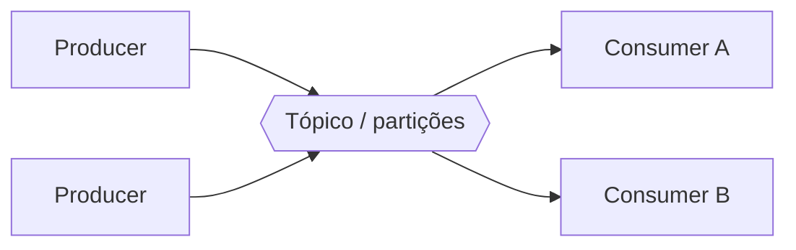
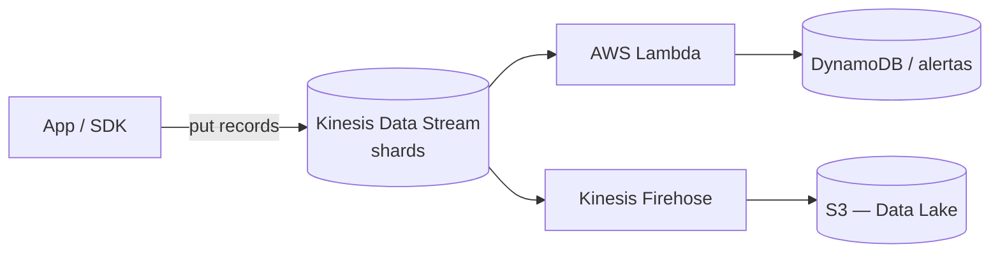

# Aula 1 — Processamento em streaming

Do Apache Kafka ao Amazon Kinesis

<!--
Aula 1 da PDN (fatia vertical inicial). Esta disciplina ainda não tem PDF
original extraído; o conteúdo segue o padrão didático da GDBD e o domínio de
streaming, para o instrutor refinar com o material real.

Narrativa: estudo de caso -> open source (Kafka) -> trazendo para AWS (Kinesis)
-> serviço gerenciado -> prós/contras -> prática -> fechamento.
Ver .kiro/steering/didatica.md.

PONTUALIDADE: na aula 1, avise que as aulas começam no horário (tolerância de
10 min). A partir da aula 2, os primeiros 30 min são para dúvidas / terminar
atividades. Ver agenda/plano-de-aula.md.
-->

---

## Apresentações

Antes de começar, uma rodada rápida:

- Qual o seu nome?
- Com o que você trabalha hoje?
- Já lidou com dados em **tempo real** (logs, eventos, sensores)?
- Qual seu objetivo nesta disciplina?

---
layout: center
---

## De onde viemos

Na GDBD tratamos dados **em lote** (batch): arquivos que chegam, são catalogados
e consultados. Mas muitos dados **não esperam** o lote.

---

## Estudo de caso

Nosso produto agora gera **eventos contínuos**:

- Cliques e navegação de usuários (clickstream).
- Logs de aplicação em tempo real.
- Telemetria de dispositivos / sensores (IoT).
- Transações que precisam de **detecção de fraude na hora**.

O negócio quer reagir em **segundos**, não no relatório do dia seguinte.

---
layout: center
---

## O problema central

### Como ingerir e processar dados que chegam **sem parar**, em alta taxa?

Lote não serve: não dá para "esperar o arquivo fechar". Precisamos de um fluxo
contínuo — um **stream**.

---

## Lote vs streaming

| | Lote (batch) | Streaming |
|---|---|---|
| Chegada do dado | Em blocos, periódica | Contínua, evento a evento |
| Latência | Minutos a horas | Segundos ou menos |
| Exemplo | Relatório diário de vendas | Alerta de fraude ao vivo |
| Serviço típico (AWS) | Glue, EMR | **Kinesis**, MSK |

---
layout: section
---

# Mundo open source

Apache Kafka

---

## Apache Kafka

Plataforma de **streaming de eventos** distribuída, padrão de mercado.

- **Producers** publicam mensagens em **tópicos**.
- Tópicos são divididos em **partições** (paralelismo e ordem por partição).
- **Consumers** leem no seu próprio ritmo; as mensagens ficam **retidas** por um
  período (reprocessamento é possível).
- Um **broker** (cluster) guarda e serve os dados.

---

## Kafka: poderoso, mas com TCO

- Você opera o cluster: brokers, dimensionamento, resiliência, upgrades.
- Precisa gerenciar retenção, rebalanceamento e monitoração.

### O mesmo gancho da GDBD: alto **TCO** → vem a nuvem gerenciada.

---
layout: section
---

# Trazendo para a AWS

Amazon Kinesis

---

## Amazon Kinesis — a família

- **Kinesis Data Streams** — o "Kafka gerenciado" da AWS: streams divididos em
  **shards**, pay as you go.
- **Kinesis Data Firehose** — entrega o stream quase sem código em destinos
  (S3, Redshift, OpenSearch), com buffering e conversão de formato.
- **Managed Service for Apache Flink** — processamento/analytics sobre o stream
  (janelas, agregações em tempo real).

> Quer o **Kafka de verdade** gerenciado? **Amazon MSK** (Managed Streaming for
> Apache Kafka) — menos lock-in, para quem já é Kafka.

---

## Kinesis Data Streams

- O stream tem **shards**; cada shard dá uma capacidade fixa de leitura/escrita.
- Escala ajustando o número de shards (ou modo **on-demand**).
- **Pay as you go**; retém os dados por um período (reprocessamento possível).

Repare: o stream alimenta o **Data Lake** da GDBD — lote e streaming convergem.

---

## Kafka → AWS: o mapa

| Necessidade | Open source | AWS |
|---|---|---|
| Streaming de eventos | Apache Kafka | **Kinesis Data Streams** / **MSK** |
| Entrega para storage | Kafka Connect | **Kinesis Data Firehose** |
| Analytics no stream | Kafka Streams / Flink | **Managed Service for Apache Flink** |
| Reação por evento | consumer custom | **AWS Lambda** |

---

## Prós e contras — Kinesis

**Prós**
- Serverless/gerenciado; sem operar broker.
- Integração nativa (Lambda, Firehose, S3, Flink).
- Escala por shard ou on-demand.

**Contras**
- Maior **vendor lock-in** que Kafka/MSK.
- Limites por shard exigem dimensionamento.
- Para quem já tem Kafka, **MSK** pode fazer mais sentido.

---
layout: section
---

# Prática

Lab 01 — Ingestão com Kinesis + Firehose → S3

---

## Prática: stream até o Data Lake

**Problema:** ingerir eventos em um **Kinesis Data Stream** e entregá-los no
**S3** via **Firehose**, deixando-os prontos para consulta (ligando ao Data Lake
da GDBD).

**Resultado esperado:** eventos enviados ao stream aparecem como arquivos no S3.

**Tempo:** 45 min

Instruções versionadas: `labs/lab-01-kinesis-firehose/`

<!--
Rode o dry-run.sh do lab ANTES da aula. Ligue ao conceito: shards, buffering do
Firehose e a convergência streaming → Data Lake.
-->

---

## Fechamento

- **Open source → AWS:** Apache Kafka → **Kinesis Data Streams** (ou **MSK**).
- **Firehose** leva o stream ao **S3** com pouco código → alimenta o Data Lake.
- **Lote e streaming convergem**: o que aprendemos na GDBD recebe, agora, dados
  em tempo real.
- Escolha pelo contexto: nascer na AWS → Kinesis; já tem Kafka → MSK.

### Dúvidas?

<!-- Fim da Aula 1 da PDN (fatia vertical inicial). -->
