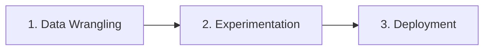
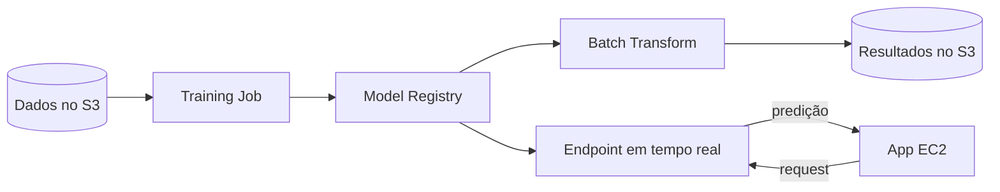
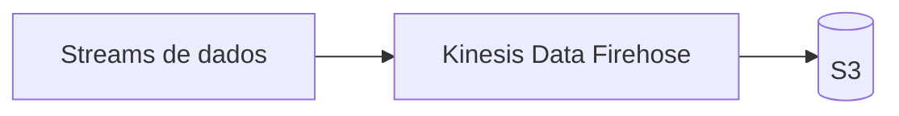

# Aula 2 — Machine Learning na AWS

Amazon SageMaker e pipelines de ML

<!--
Aula 2 da PDN. Origem: pdn_2025_parte1 (slides 11-57) e pdn_2025_aula2.
Aula de 18h30-22h (quinta): teoria + prática mescladas.

PONTUALIDADE: primeiros 30 min para dúvidas da Aula 1 / seminário, enquanto
os alunos chegam. Ver plano-de-aula.md.
-->

---

## Primeiros 30 minutos

Enquanto a turma chega:

- Dúvidas da Aula 1 (EMR Serverless, RuntimeRole, preço/TCO)?
- Andamento do **Seminário** (grupos, serviço sorteado, dúvidas)?

<!-- Não avance antes dos 30 min. -->

---

## O problema: como colocar modelos de ML em produção?

Treinar um modelo é só o começo. Para ele **servir** de verdade, alguém precisa
gerenciar:

- **Servidor**, **Python**, **bibliotecas**, **GPU**
- **Treinamento** (distribuído, reproduzível)
- **API** de inferência, **escala** e **monitoramento**

### É muita infraestrutura entre o notebook e a produção.

---

## ML na AWS — três perfis

O mesmo fluxo de ML atende papéis diferentes:

- **Developer** — integra o modelo na aplicação.
- **Data Scientist** — explora dados e treina modelos.
- **Researcher** — experimenta algoritmos e frameworks.

O SageMaker cobre o ciclo de todos eles.

---

## As 3 etapas do processo de ML

1. **Data Wrangling** — preparar o ambiente dos Notebooks e levar os dados até
   eles de forma segura.
2. **Experimentation** — set up e gerência de **clusters**; escalar/distribuir
   algoritmos de ML.
3. **Deployment** — gerenciar clusters, criar e **escalar APIs de inferência**,
   testar, versionar e **monitorar**.

---
layout: center
---

## Amazon SageMaker

Serviço da AWS que provê ferramentas mais rápidas e fáceis para o trabalho de
Data Science **colocar modelos de ML em produção**.

---

## Amazon SageMaker — o que é

- Ferramenta de Machine Learning **de ponta a ponta**.
- **Fácil de aprender** e **flexível** em frameworks.
- **Pagamento por segundo** (pay as you go).

Facilitador de **treinamento distribuído**:
- Algoritmos otimizados pela Amazon, **Apache Spark**, Deep Learning
  (Gluon, TensorFlow, mxnet).
- **Customização**: traga seu **container Docker** para a AWS.

---

## Como funciona

- Baseado em **Jupyter Notebook**, com arquitetura modular.
- Framework para **gerência de hardware** (GPU/CPU sob demanda).
- **Registrador de treinamento** e **registrador de modelos**.
- **Exportação automática** do modelo para produção.

Na prática, o fluxo no Notebook é: **manipular os dados → treinar o modelo →
fazer o deploy**.

---

## Resumo: antes × com SageMaker

| Antes (você gerencia) | Com Amazon SageMaker |
|---|---|
| Servidor | **Notebook** gerenciado |
| Python | Ambiente gerenciado |
| Bibliotecas | Frameworks integrados |
| GPU | Infraestrutura **sob demanda** |
| Treinamento | **Training Job** |
| Modelo | **Model Registry** |
| API | **Endpoint** |
| Monitoramento | **Monitoring** |

### Cada dor de infraestrutura vira um recurso gerenciado.

---

## Prática da aula

**Lab — Amazon SageMaker** (detalhado na Aula 3, de sábado):

- Manipular dados, treinar e fazer deploy de um modelo no SageMaker.
- Tempo reservado em aula de lab: **1h30**.

Instruções versionadas: `labs/lab-02-sagemaker/`

---
layout: section
---

# Implementação de pipeline de ML

Do treino à produção

---

## O deploy de modelos de ML na AWS

Duas formas de servir um modelo:

- **Batch Transform** — inferência em lote sobre um conjunto de dados.
- **Real time (Endpoint)** — inferência sob demanda, requisição a requisição.

### Qual é o mais desafiador? O **real time** — exige API escalável, baixa
latência e monitoração contínua.

---

## Fluxo básico de produção

Um modelo treinado vira **Batch** (lote) ou **Endpoint** (tempo real) conforme a
necessidade do consumidor.

---

## Referências

- SageMaker — inference pipelines (batch e real time):
  https://docs.aws.amazon.com/sagemaker/latest/dg/inference-pipelines.html
- SageMaker Pipelines: https://aws.amazon.com/pt/sagemaker/pipelines/
- Exemplos: https://github.com/aws/amazon-sagemaker-examples

---
layout: section
---

# Extra — Escolhendo o Data Store

Qual arquitetura é mais barata?

---

## O problema de custo

Mesma carga, dois destinos. Cenário base:

- **300 escritas/seg**, **777.600.000 objetos/mês**.
- Comparar **DynamoDB** vs **Amazon S3** para guardar esses dados.

### A escolha do data store muda a conta em **ordens de grandeza**.

---

## Cenário 1 — objeto pequeno (2.048 bytes, 1.483 GB/mês)

| | DynamoDB | Amazon S3 |
|---|---|---|
| Storage | US$ 364,50 (indexed) | US$ 34,11 |
| Requests / Throughput | US$ 284,70 | US$ 3.888,00 (PUT/LIST) |
| **Total/mês** | **US$ 649,20** | **US$ 3.922,11** |

Com objeto pequeno e muitas requisições, o **DynamoDB sai mais barato** — o custo
de PUT no S3 pesa.

---

## Cenário 2 — objeto maior (32.768 bytes, 23.730 GB/mês)

| | DynamoDB | Amazon S3 |
|---|---|---|
| Storage | US$ 5.926,25 (indexed) | US$ 545,79 |
| Requests / Throughput | US$ 4.555,20 | US$ 3.888,00 |
| **Total/mês** | **US$ 10.481,45** | **US$ 4.433,79** |

Com objeto maior e muito volume, o **S3 vira o mais barato** — o storage indexado
do DynamoDB dispara.

### A resposta "qual é mais barato" é: **depende do perfil da carga**.

---

## E se inserirmos o Kinesis Data Firehose?

Colocar o **Firehose** na frente, agregando os streams antes de gravar no S3,
muda tudo no Cenário 2:

| Item | Valor |
|---|---|
| Kinesis Data consumido | US$ 752,68 |
| Storage (S3) | US$ 545,79 |
| PUT/LIST (S3) | US$ 0,05 |
| **Total/mês** | **US$ 1.298,52** |

O Firehose **agrega** os eventos e derruba o custo de PUT (de US$ 3.888 para
US$ 0,05): de ~US$ 4.433 para **~US$ 1.298/mês**.

---

## Fechamento

- **SageMaker** transforma cada dor de infra de ML (servidor, GPU, API,
  monitoração) em um recurso gerenciado (Notebook, Training Job, Endpoint…).
- Deploy: **Batch** vs **real time (Endpoint)** conforme o consumidor.
- **Custo é arquitetura:** data store e o uso de **Firehose** mudam a conta em
  ordens de grandeza — projete pensando no perfil da carga.

### Dúvidas?

<!-- Fim da Aula 2 da PDN. -->
