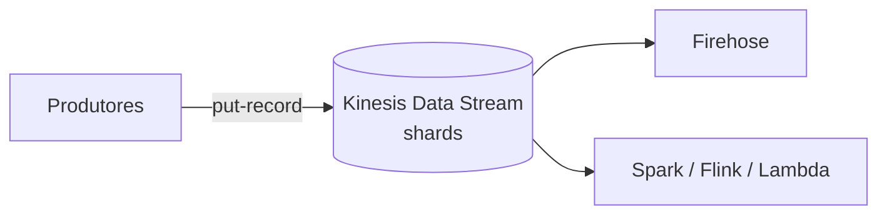
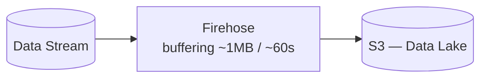

# Aula 2 — Streaming na AWS

Do Spark Streaming ao Kinesis + Firehose · PDN · quinta · 18h30–22h

<!--
Aula 2 da PDN (protagonista: streaming). Origem: conceito de streaming + o bloco
de custos (pdn_2025_parte1 slides 46-57). Flink é só CITADO, não aprofundado.
Refino: abertura com objetivos + roteiro; teoria enxuta → lab; "o que você leva".

CONDUÇÃO: primeiros 30 min para dúvidas da Aula 1 / terminar o Lab A.
-->

---

## O que você vai levar desta aula

Ao final, você será capaz de:

- Ligar o **Spark Streaming** que você já conhece ao **streaming gerenciado** da AWS.
- Explicar **Kinesis Data Streams** (shards) e **Firehose** (entrega no S3).
- Argumentar uma **decisão de arquitetura por custo** (DynamoDB vs S3 vs Firehose).
- Montar um pipeline **produtor → Kinesis → Firehose → S3** (Lab B, início).

---

## Roteiro de hoje (3h30)

| Tempo | Bloco |
|---|---|
| 0:00–0:30 | Chegada: dúvidas da Aula 1 / terminar o Lab A |
| 0:30–1:00 | Ponte: do Spark Streaming ao streaming na nuvem |
| 1:00–1:40 | Kinesis Data Streams + Firehose |
| 1:40–2:00 | Custo é arquitetura (DynamoDB vs S3 vs Firehose) |
| 2:00–2:15 | **Intervalo** |
| 2:15–3:20 | **Lab B** — produtor → Kinesis → Firehose → S3 (início) |
| 3:20–3:30 | Fechamento + o que vem (SageMaker no sábado) |

---
layout: center
---

## De onde viemos

Vocês acabaram de ver **Spark Streaming**: dados que chegam **continuamente** e
são processados em **micro-batches**.

### Pergunta: e quando os dados chegam de **milhares de fontes ao mesmo tempo**
### — quem recebe esse fluxo de forma confiável antes do Spark processar?

<!--
Puxe a memória recente do Spark Streaming. A lacuna — "quem ingere o fluxo?" —
é o espaço do Kinesis. Deixe a turma chegar nisso.
-->

---

## Lote vs streaming

| | Lote (batch) | Streaming |
|---|---|---|
| Chegada | Em blocos, periódica | Contínua, evento a evento |
| Latência | Minutos a horas | Segundos ou menos |
| Exemplo | Tabela de classificação diária | Placar/gol ao vivo |
| No curso | EMR Serverless (Aula 1) | **Kinesis** (hoje) |

---

## A ponte: Spark Streaming → AWS

| Papel | Open source | AWS |
|---|---|---|
| Ingerir o fluxo de eventos | Apache Kafka | **Kinesis Data Streams** |
| Entregar o fluxo no storage | Kafka Connect | **Kinesis Data Firehose** |
| Processar o stream (analytics) | **Spark Streaming** / Flink | Spark no EMR · **Managed Flink** |

> Hoje focamos em **Data Streams + Firehose** (ingestão e entrega). O
> **Managed Service for Apache Flink** é "o lugar do Spark Streaming gerenciado"
> na AWS — citamos, mas no lab o processamento fica com o **próprio Spark**.

<!--
Deixe explícito o recorte: não vamos mergulhar em Flink. O Spark deles continua
sendo o motor de processamento — só muda de onde o dado vem.
-->

---

## Kinesis Data Streams

- O stream tem **shards**; cada shard dá uma capacidade fixa (1 MB/s, 1000 reg/s).
- **Produtores** gravam registros (`put-record`); **consumidores** leem no seu ritmo.
- Os dados ficam **retidos** por um período → dá para **reprocessar**.
- Escala por nº de shards (ou modo on-demand). **Pay as you go.**

---

## Kinesis Data Firehose

- Entrega o stream em destinos (**S3**, Redshift, OpenSearch) com **zero código**.
- Faz **buffering** por tamanho ou tempo e grava em lotes.
- Pode converter formato e particionar na entrega.

### É a ponte natural entre o **tempo real** e o **Data Lake** da GDBD.

---
layout: section
---

# Custo é arquitetura

Exercício: qual data store escolher?

---

## O cenário (apostem antes!)

Mesma carga de escrita, dois destinos. **Palpite da turma primeiro.**

- **300 escritas/seg**, **777,6 milhões de objetos/mês**.
- **DynamoDB** ou **Amazon S3**?

<!-- Faça a turma apostar. O resultado depende do tamanho do objeto. -->

---

## Dois cenários, resultados opostos

**Cenário 1 — objeto pequeno (2 KB):**

| | DynamoDB | S3 |
|---|---|---|
| Total/mês | **US$ 649** | US$ 3.922 |

Muitas requisições pequenas → PUT do S3 pesa → **DynamoDB ganha**.

**Cenário 2 — objeto maior (32 KB, muito volume):**

| | DynamoDB | S3 |
|---|---|---|
| Total/mês | US$ 10.481 | **US$ 4.434** |

Muito volume → storage indexado do DynamoDB dispara → **S3 ganha**.

### "Qual é mais barato?" = **depende do perfil da carga**.

---

## O pulo do gato: Firehose na arquitetura

Cenário 2, agregando com **Firehose** antes de gravar no S3:

| Item | Valor |
|---|---|
| Kinesis Data consumido | US$ 752,68 |
| Storage (S3) | US$ 545,79 |
| PUT/LIST (S3) | **US$ 0,05** |
| **Total/mês** | **US$ 1.299** |

Agregar derruba o PUT de **US$ 3.888 → US$ 0,05**: de ~US$ 4.434 para **~US$ 1.299**.

### Uma peça de streaming (Firehose) muda a conta em **~3×**.

<!-- Momento "uau": arquitetura de streaming é também decisão de custo. -->

---
layout: center
---

## Intervalo — 15 min

---
layout: section
---

# Prática

Lab B — streaming de ponta a ponta

---

## Lab B — começamos agora

Pipeline: **produtor (jogos reais) → Kinesis → Firehose → S3**. Hoje montamos
essa parte; a parte **Spark Structured Streaming** fecha no sábado (reusando o
EMR Serverless do Lab A).

- Criar Data Stream (1 shard) e Firehose → S3.
- Rodar o **produtor** que lê jogos reais (openfootball) e emite como stream.
- Ver os eventos **aterrissarem no S3**.

**Timebox hoje:** ~1h. **Parada segura:** eventos no S3.

Instruções: `labs/lab-02-streaming/` · rode o `dry-run.sh` antes.

<!--
Dados reais e atuais (Premier League 2024/25, openfootball, sem API key). O
produtor "reproduz" os jogos como um fluxo. Amarre com o custo: por que Firehose.
-->

---

## O que você leva de hoje

- **Kinesis Data Streams** ingere o fluxo; **Firehose** entrega no S3 sem código.
- O **Spark Streaming** de vocês tem lugar na AWS (via Spark no EMR / Managed Flink).
- **Arquitetura de streaming é decisão de custo** — o Firehose pode cortar a conta
  em ordens de grandeza.
- Seu pipeline já leva eventos reais ao Data Lake.

### Próxima (sábado): **SageMaker** + dia de labs (inclui o Spark do Lab B).

<!-- Retome os 4 objetivos do início. -->
