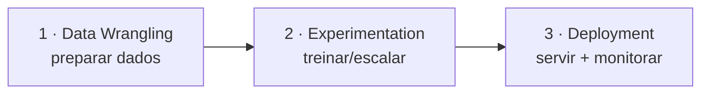
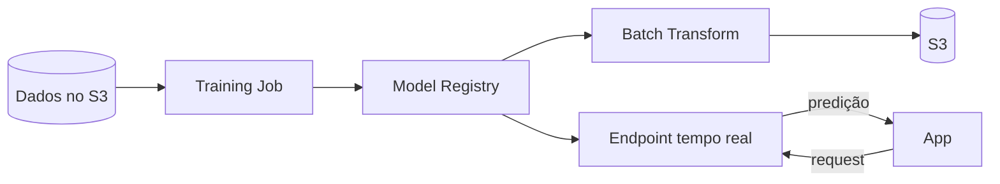

# Aula 3 — Machine Learning + dia de labs

Amazon SageMaker e mão na massa · PDN · sábado · 8h–13h

<!--
Aula 3 da PDN (sábado, ~5h). Origem: pdn_2025_parte1 (slides 11-45) e
pdn_2025_aula2. Teoria do SageMaker no começo (turma fresca) + dia de labs:
fechar Lab A (EMR Serverless), Lab C (SageMaker) e a parte Spark do Lab B.

CONDUÇÃO: primeiros 30 min para dúvidas / terminar Labs A e B.
-->

---

## O que você vai levar deste dia

- Explicar o que o **SageMaker** resolve no caminho "notebook → produção".
- Diferenciar deploy **Batch** vs **Endpoint (tempo real)** e escolher por
  custo/latência.
- Treinar e servir um modelo no **Lab C**.
- Fechar os labs do curso (EMR Serverless, streaming) e **limpar** tudo.

---

## Roteiro do dia (5h)

| Tempo | Bloco |
|---|---|
| 0:00–0:30 | Chegada: dúvidas / terminar Labs A e B |
| 0:30–2:00 | SageMaker: do notebook ao endpoint |
| 2:00–2:15 | **Intervalo** |
| 2:15–3:15 | **Lab C** — SageMaker (treino + deploy) |
| 3:15–4:30 | **Labs**: fechar Lab A e a parte Spark do Lab B |
| 4:30–4:50 | **Limpeza** (apagar Endpoint!) + conferir custo |
| 4:50–5:00 | Fechamento do curso |

---
layout: section
---

# SageMaker — do notebook à produção

---

## O problema

Treinar um modelo é a parte fácil. Para ele **servir**, alguém gerencia:

servidor · Python · bibliotecas · **GPU** · treinamento · **API** · escala ·
monitoramento.

### Mesma tensão da Aula 1 (EMR) e da Aula 2 (streaming): a **infra** domina.
### O SageMaker é a resposta gerenciada para ML.

---

## As 3 etapas do processo de ML



1. **Data Wrangling** — ambiente de notebooks; dados chegam com segurança.
2. **Experimentation** — treinar; escalar/distribuir algoritmos.
3. **Deployment** — APIs de inferência, versão, teste e monitoração.

---

## Amazon SageMaker, em uma frase

> Serviço da AWS que dá as ferramentas para **colocar modelos de ML em
> produção** — de ponta a ponta, pay as you go.

- Baseado em **Jupyter Notebook**, arquitetura modular.
- Treinamento distribuído: algoritmos da Amazon, Spark, Deep Learning, ou **seu
  container Docker**.
- **Training Job**, **Model Registry**, export automático para produção.

---

## O que muda, na prática

| Antes (você gerencia) | Com SageMaker |
|---|---|
| Servidor | **Notebook** gerenciado |
| Python / bibliotecas | Ambiente + frameworks |
| GPU | Infra **sob demanda** |
| Treinamento | **Training Job** |
| Modelo | **Model Registry** |
| API | **Endpoint** |
| Monitoramento | **Monitoring** |

---

## Servir o modelo: Batch vs tempo real



- **Batch Transform** — inferência em lote; sem servidor permanente.
- **Endpoint** — tempo real; **cobra enquanto existir** (o vilão de custo).

### Escolha por **latência e custo**. Não precisa de tempo real? Use Batch.

---
layout: center
---

## Intervalo — 15 min

---
layout: section
---

# Dia de labs

Mão na massa (tema futebol, dados reais e atuais)

---

## Os três labs do curso

| Lab | Tema | Status ao chegar no sábado |
|---|---|---|
| **A** — EMR Serverless | Spark batch gerenciado | iniciado na Aula 1 → **fechar** |
| **B** — Streaming | Kinesis + Firehose + **Spark** | ingestão feita → **fechar a parte Spark** |
| **C** — SageMaker | treino + deploy de modelo | **fazer hoje** |

Todos usam dados **públicos e atuais** (openfootball, sem API key). Rode o
`dry-run.sh` de cada um antes.

---

---
routeAlias: lab-c
---

## Lab C — SageMaker (agora)

- Preparar execution role + dados; disparar um **Training Job**.
- Fazer o **deploy**: **Batch Transform** (recomendado no lab) ou **Endpoint**.
- **Parada segura:** Training Job concluído e modelo registrado.

Instruções: `labs/lab-03-sagemaker/`.

---

## Fechar Lab A e a parte Spark do Lab B

- **Lab A:** terminar o job PySpark no EMR Serverless (dependências Python, extra).
- **Lab B — Spark Structured Streaming:** rodar, **no EMR Serverless do Lab A**,
  o job que lê o `eventos/` do S3 (que o Firehose encheu) em **micro-batches** e
  grava agregados. É o Spark Streaming de vocês, agora sobre dados da nuvem.

Instruções: `labs/lab-01-emr-serverless/` e `labs/lab-02-streaming/` (passo 6).

---
layout: center
---

## Limpeza — antes de sair!

```bash
# o ENDPOINT do SageMaker é o que mais cobra
aws sagemaker delete-endpoint --endpoint-name <ENDPOINT>
# o SHARD do Kinesis cobra enquanto o stream existir
aws kinesis delete-stream --stream-name lab-pdn-stream --enforce-consumer-deletion
aws firehose delete-delivery-stream --delivery-stream-name lab-pdn-firehose
# EMR Serverless Application + buckets dos labs
```

<!-- Reserve 15-20 min reais para a limpeza. Confira o billing depois. -->

---

## Fechamento do curso

A PDN pegou o Spark que vocês já sabiam e levou para a nuvem:

- **EMR Serverless** — Spark batch sem operar cluster.
- **Kinesis + Firehose** — streaming gerenciado, do evento ao Data Lake.
- **Spark Structured Streaming** — o processamento de vocês, sobre dados da nuvem.
- **SageMaker** — do dado ao modelo em produção.
- **Custo é arquitetura** — a decisão certa muda a conta em ordens de grandeza.

### Obrigado! Dúvidas e entrega final.

<!-- Retome os objetivos do dia e do curso. -->
